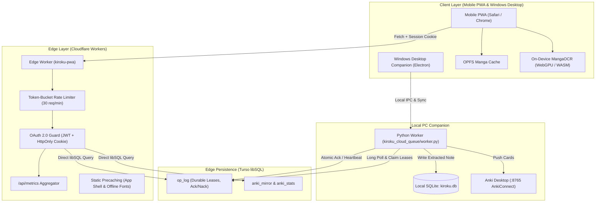
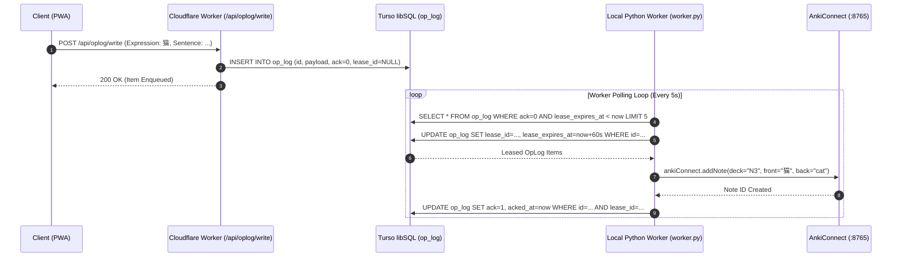

# Kiroku Note PWA & Cloud Queue Architecture

This document describes the end-to-end architecture connecting the Kiroku Note Progressive Web App (PWA), Cloudflare Worker edge router, Turso libSQL edge database, and the local Windows companion worker.

---

## 1. System Topology Overview



---

## 2. Authentication & Session Flow

```mermaid
sequenceDiagram
    autonumber
    actor User as Learner
    participant PWA as Client (PWA)
    participant Worker as Cloudflare Worker (/auth/*)
    participant OAuth as Identity Provider (Google / GitHub)

    User->>PWA: Click "Sign in with Google / GitHub"
    PWA->>Worker: GET /auth/google
    Worker->>OAuth: Redirect to OAuth Consent Screen
    OAuth-->>User: Present Login & Permission Prompt
    User->>OAuth: Authorize Application
    OAuth->>Worker: GET /auth/callback/google?code=...
    Worker->>OAuth: Exchange code for access token & user profile
    Worker->>Worker: Sign HMAC-SHA256 JWT Token
    Worker-->>PWA: Set-Cookie: session=...; HttpOnly; Secure; SameSite=Lax
    Worker-->>PWA: Redirect to / (Authenticated App Shell)
    PWA->>Worker: GET /api/metrics (Authenticated via Cookie)
    Worker-->>PWA: 200 OK (Queue & Anki Stats)
```

---

## 3. Vocabulary Mining & Durable Lease Lifecycle


