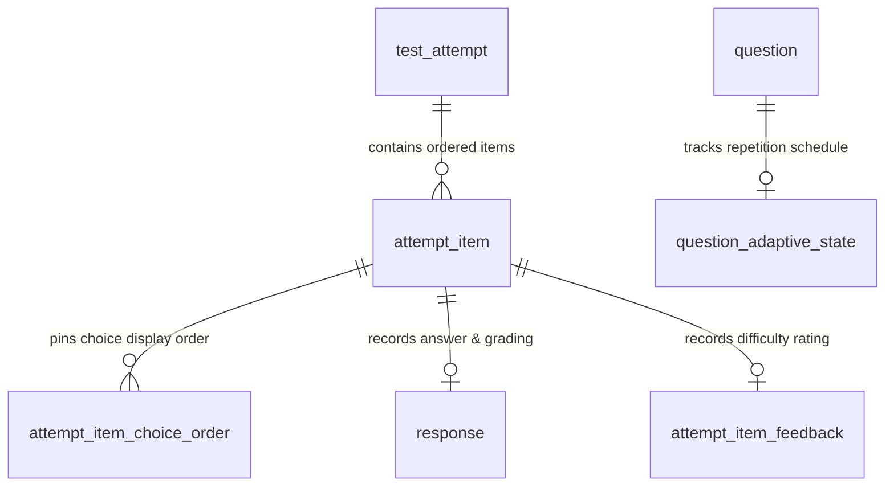
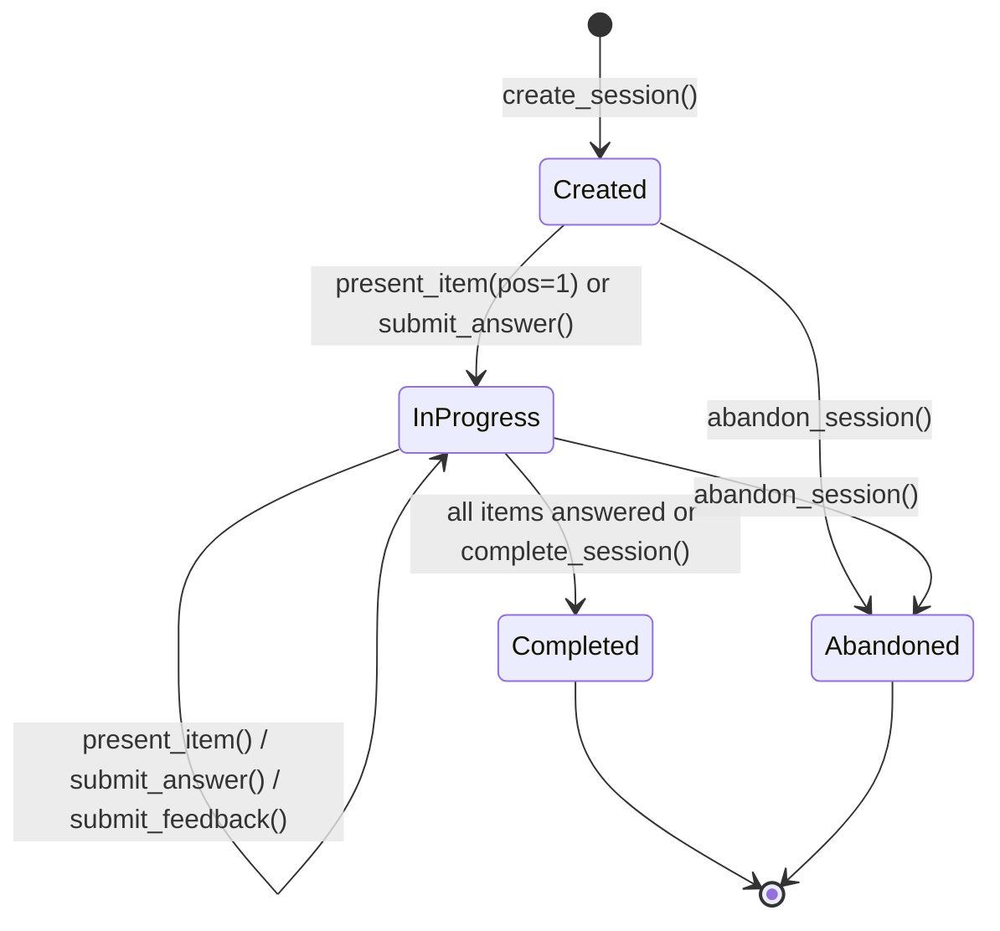

# Kiroku Note — JLPT Question Bank: M6 Learning & Practice Engine

**Document ID:** `docs/study-bank/15-m6-learning-practice-engine.md`  
**Milestone:** Kiroku M6 Learning & Practice Engine  
**Date:** 2026-10-30  
**Status:** Authoritative Architecture, Implementation & Verification Report  
**Target Subsystem:** Local-First JLPT Study Database & Practice Engine (`study.db`)  
**Preceding Deliverables:** `docs/study-bank/00` through `14`  

---

## 1. Executive Summary

Milestone 6 establishes the **Learning & Practice Engine** for Kiroku Note, activating the approved and dual-model verified question bank populated in M5-B (63 active approved JLPT questions, 35 content-addressed binary assets).

M6 provides a robust, local-first, deterministic foundation for:
1. **Practice Sessions:** Creating, configuring, resuming, completing, and abandoning casual and focused practice sessions.
2. **Approved Question Selection:** Deterministic candidate selection strictly enforcing authoritative eligibility checks (`evaluate_eligibility`) and excluding draft, invalid, or quarantined material.
3. **Deterministic Grading:** Fast, zero-LLM objective answer grading verifying choices against pinned revisions and canonical answers.
4. **Decoupled Difficulty Feedback:** Explicit learner ratings (`Easy`, `Normal`, `Hard`) captured separately from correctness.
5. **Adaptive Repetition Policy:** Explainable priority scoring with deprioritization after two consecutive correct Easy ratings, higher priority for incorrect and Hard questions, and consecutive-session avoidance.
6. **Active Duration & Timing Persistence:** Validated, persistent per-question timing and active session duration calculation robust against interruptions.
7. **Learning Analytics:** High-performance, lightweight SQL aggregations reporting overall accuracy, JLPT level and format breakdowns, trouble questions, mastered questions, and recent session history.

---

## 2. Database Schema & Migration 0005

Migration `0005_learning_practice_engine.sql` enhances the initial practice persistence foundation into a comprehensive practice engine schema with STRICT typing, `ON DELETE RESTRICT` composite foreign keys, and immutability triggers.

### 2.1 Schema Entities

1. **`test_attempt`**:
   - `id`: INTEGER PRIMARY KEY AUTOINCREMENT
   - `external_id`: TEXT UNIQUE NOT NULL (ULID)
   - `session_type`: TEXT NOT NULL DEFAULT 'practice' (`practice`, `casual`, `exam`)
   - `status`: TEXT NOT NULL DEFAULT 'created' (`created`, `in_progress`, `completed`, `abandoned`)
   - `level`: TEXT DEFAULT NULL (`N1`–`N5`)
   - `category`: TEXT DEFAULT NULL (`vocabulary`, `grammar`, `reading`, `listening`)
   - `format_code`: TEXT DEFAULT NULL
   - `recipe_snapshot_json`: TEXT DEFAULT NULL (exact creation configuration snapshot)
   - `seed`: INTEGER NOT NULL (deterministic ordering seed)
   - `created_at`, `started_at`, `completed_at`, `last_active_at`: ISO 8601 timestamps
   - `total_elapsed_ms`: INTEGER NOT NULL DEFAULT 0 (sum of active question durations)

2. **`attempt_item`**:
   - `id`: INTEGER PRIMARY KEY AUTOINCREMENT
   - `attempt_id`: INTEGER NOT NULL (FK `test_attempt.id`)
   - `position`: INTEGER NOT NULL (1-indexed order within session)
   - `question_id`: INTEGER NOT NULL (FK `question.id`)
   - `pinned_question_revision_id`: INTEGER NOT NULL (FK `question_revision.id`)
   - `group_id`: INTEGER DEFAULT NULL (FK `content_group.id`)
   - `pinned_group_revision_id`: INTEGER DEFAULT NULL (FK `group_revision.id`)
   - `anchor_key`: TEXT DEFAULT NULL
   - `presented_at`: TEXT DEFAULT NULL (recorded upon first item display)
   - `created_at`: ISO 8601 timestamp

3. **`attempt_item_choice_order`**:
   - `id`: INTEGER PRIMARY KEY AUTOINCREMENT
   - `attempt_item_id`: INTEGER NOT NULL (FK `attempt_item.id`)
   - `choice_id`: INTEGER NOT NULL (FK `revision_choice.id`)
   - `display_position`: INTEGER NOT NULL (1-indexed display order)

4. **`response`** (Append-only Graded Ledger):
   - `id`: INTEGER PRIMARY KEY AUTOINCREMENT
   - `attempt_item_id`: INTEGER UNIQUE NOT NULL (FK `attempt_item.id`)
   - `selected_choice_id`: INTEGER DEFAULT NULL (FK `revision_choice.id`)
   - `pinned_question_revision_id`: INTEGER NOT NULL
   - `is_correct`: INTEGER NOT NULL CHECK (`is_correct IN (0, 1)`)
   - `grading_status`: TEXT NOT NULL DEFAULT 'graded' (`graded`, `invalid`, `unsupported`)
   - `submitted_answer`: TEXT DEFAULT NULL
   - `canonical_choice_id`: INTEGER DEFAULT NULL (FK `revision_choice.id`)
   - `time_spent_ms`: INTEGER NOT NULL DEFAULT 0
   - `answered_at`: ISO 8601 timestamp

5. **`attempt_item_feedback`** (Decoupled User Difficulty Feedback):
   - `id`: INTEGER PRIMARY KEY AUTOINCREMENT
   - `attempt_item_id`: INTEGER UNIQUE NOT NULL (FK `attempt_item.id`)
   - `difficulty_rating`: TEXT NOT NULL CHECK (`difficulty_rating IN ('easy', 'normal', 'hard')`)
   - `created_at`: ISO 8601 timestamp

6. **`question_adaptive_state`** (Repetition & Scheduling Cache):
   - `question_id`: INTEGER PRIMARY KEY (FK `question.id`)
   - `total_attempts`: INTEGER NOT NULL DEFAULT 0
   - `total_correct`: INTEGER NOT NULL DEFAULT 0
   - `consecutive_correct_easy`: INTEGER NOT NULL DEFAULT 0
   - `last_attempted_at`: ISO 8601 timestamp
   - `last_session_id`: INTEGER DEFAULT NULL (FK `test_attempt.id`)
   - `last_rating`: TEXT DEFAULT NULL (`easy`, `normal`, `hard`)
   - `last_is_correct`: INTEGER DEFAULT NULL (0 or 1)
   - `priority_score`: REAL NOT NULL DEFAULT 100.0
   - `updated_at`: ISO 8601 timestamp

### 2.2 Immutability Triggers

The 9 immutability and consistency triggers enforce:
- `trg_response_insert_check`: Responses can only be inserted into sessions that are active (`created` or `in_progress`).
- `trg_response_no_update` & `trg_response_no_delete`: Response records are append-only.
- `trg_attempt_item_no_update`: Core attempt item fields are immutable; only `presented_at` may transition from `NULL` to timestamp once.
- `trg_attempt_item_choice_order_no_update` & `delete`: Choice display ordering is strictly immutable.
- `trg_attempt_item_validate`: Enforces standalone questions have NULL group foreign keys and grouped questions match group revision anchors.

---

## 3. Session Lifecycle & State Machine

1. **Created:**
   - Candidate questions selected, deduplicated, and pinned in `attempt_item`.
   - Items prepared for presentation without revealing canonical answers.
2. **In Progress:**
   - Activated automatically upon presenting the first question or submitting an answer.
   - `started_at` recorded; active duration tracked.
3. **Completed:**
   - Triggered automatically when all items are answered, or explicitly via `complete_session()`.
   - `completed_at` finalized. Rejects further answer submissions.
4. **Abandoned:**
   - User exits before completion. Preserves all answered items, responses, and feedback for learning analytics without corrupting completion statistics.

---

## 4. Deterministic Answer Grading

Grading is executed by `DeterministicGrader`:
- **Strict Validation:** Submitted `choice_id` must exist and belong to the item's pinned revision. Invalid choices raise `InvalidChoiceError`.
- **Authoritative Resolution:** Retrieves canonical `revision_answer` for the pinned revision.
- **Grader Dispatch:** Objective comparison for `single_choice` (`is_correct = (selected_choice_id == canonical_choice_id)`).
- **Audit Persistence:** Records submitted choice, canonical choice, correctness (0/1), and rationale markup.
- **Zero AI:** Purely deterministic, offline, and sub-millisecond execution.

---

## 5. Adaptive Repetition & Scheduling Policy

Selection uses an explainable priority scoring formula:

$$\text{Priority} = f(\text{attempts}, \text{correctness}, \text{rating}, \text{consecutive\_easy}, \text{recency})$$

| Scenario | Condition | Priority Score | Action |
|:---|:---|:---:|:---|
| **Incorrect + Hard** | `last_is_correct == 0` and `last_rating == 'hard'` | **250.0** | Highest immediate repetition |
| **Incorrect** | `last_is_correct == 0` | **200.0** | High repetition priority |
| **Correct + Hard** | `last_is_correct == 1` and `last_rating == 'hard'` | **160.0** | Reinforced repetition |
| **Unpracticed (Fresh)**| `total_attempts == 0` | **120.0** | Baseline exploration |
| **Correct + Normal** | `last_is_correct == 1` and `last_rating == 'normal'` | **80.0** | Moderate pacing |
| **Correct + Easy (Once)**| `consecutive_correct_easy == 1` | **40.0** | Deprioritized |
| **Mastered (Easy Twice)**| `consecutive_correct_easy >= 2` | **5.0** | Strongly deprioritized (never purged) |

### Consecutive Session Avoidance
When the candidate pool outside the previous session exceeds the requested limit, questions that appeared in the immediately preceding session receive a 90% priority reduction ($\times 0.1$), ensuring fresh questions appear across consecutive sessions.

---

## 6. Timing Model

1. **Item Duration (`time_spent_ms`):**
   - Active duration spent by learner interacting with the item.
   - Validated: rejected if negative; capped to 30 minutes (1,800,000 ms) to prevent distortion if left idle.
2. **Session Duration (`total_elapsed_ms`):**
   - Calculated as the sum of active item durations ($\sum \text{time\_spent\_ms}$).
   - Independent of wall-clock calendar time between `started_at` and `completed_at`, ensuring interrupted and resumed sessions maintain accurate study metrics.

---

## 7. Learning Analytics & Reporting

`PracticeAnalyticsService` exposes zero-overhead analytical views:
- **`get_learning_summary()`**: Total sessions, completed count, accuracy rate, total study time, average time per question.
- **`get_accuracy_by_level()`**: Accuracy breakdown across N1–N5.
- **`get_accuracy_by_family()`**: Accuracy breakdown by question format (e.g. `kanji_reading`, `sentential_grammar_1`, `comprehension_short`).
- **`get_trouble_questions()`**: Ranked list of questions repeatedly answered incorrectly.
- **`get_mastered_questions()`**: Questions answered correctly and rated Easy twice.
- **`get_recent_activity()`**: Chronological list of recent sessions and performance.

---

## 8. Verification & Empirical Results

The test suite in `backend/tests/test_study_practice_engine.py` validates all 14 acceptance criteria:
1. Session creation using only eligible, approved questions: **PASS**
2. Exclusion of quarantined and ineligible questions: **PASS**
3. Stable question IDs and revision references: **PASS**
4. Session resume and lifecycle transitions: **PASS**
5. Deterministic grading across supported formats: **PASS**
6. Invalid and incomplete answer handling: **PASS**
7. Easy/Normal/Hard feedback persistence: **PASS**
8. Adaptive deprioritization after two correct Easy attempts: **PASS**
9. Incorrect and Hard questions receiving higher repetition priority: **PASS**
10. Intra-session deduplication and consecutive session avoidance: **PASS**
11. Per-question and session timing persistence: **PASS**
12. Interrupted session timing validation and capping: **PASS**
13. History and analytics correctness: **PASS**
14. Database migrations, doctor checks and integrity: **PASS**

Database Doctor (`run_doctor`) confirms **0 errors and 0 warnings** on both test and live databases.

---

## 9. Deferrals for M7

The following items are explicitly deferred to Milestone 7:
- Official JLPT section timing (Language Knowledge 105m/110m, Listening 30m/35m).
- Full JLPT blueprint assembly (exact question count per format per level).
- Official scaled scoring (0–60 Language Knowledge, 0–60 Reading, 0–60 Listening, pass/fail thresholds).
- Desktop UI practice and examination screens.
- Explanation generation (LLM prompt synthesis).

