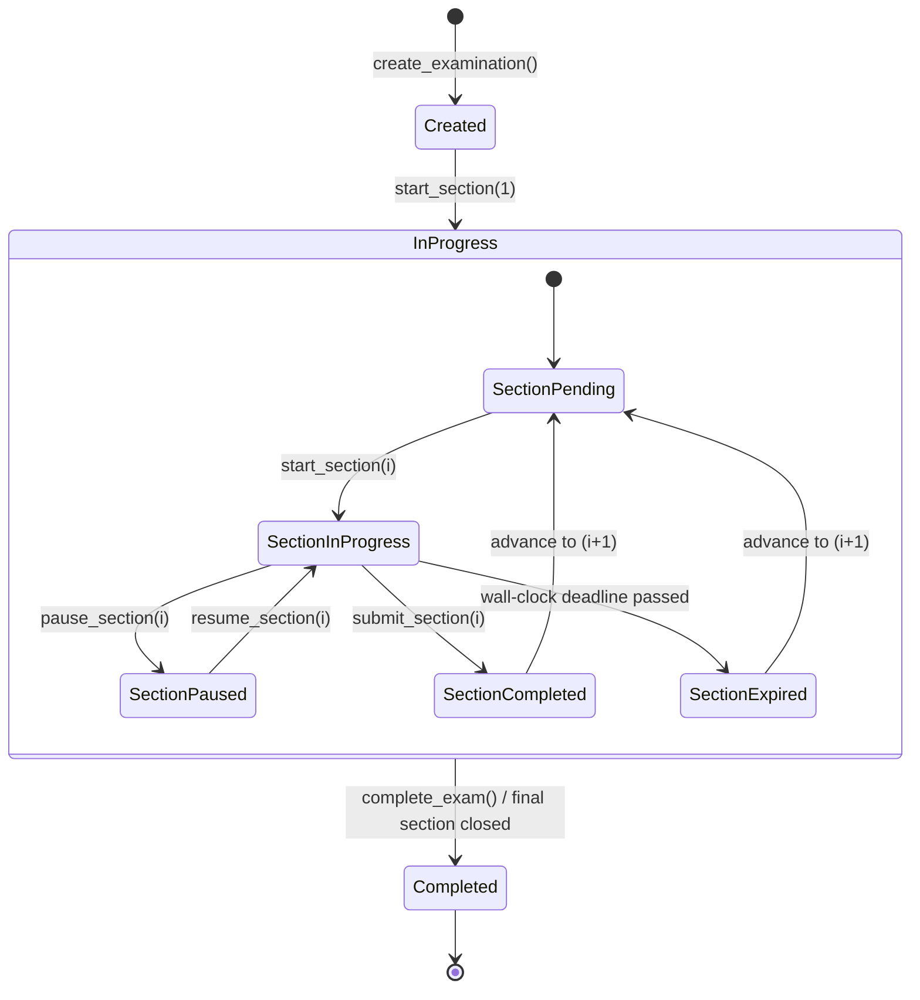
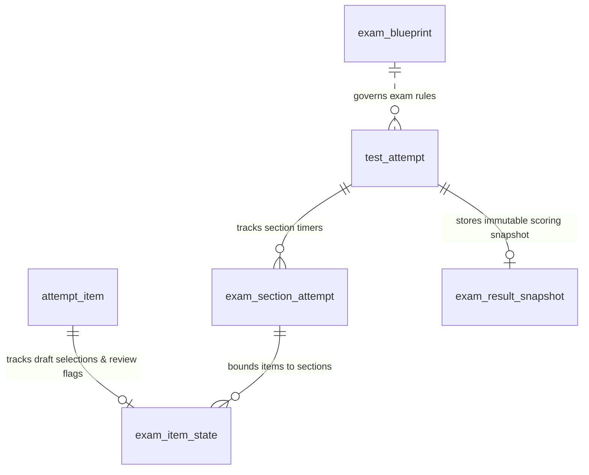

# Kiroku Note — JLPT Question Bank: M7 Examination Generation & Scoring Engine

**Document ID:** `docs/study-bank/16-m7-jlpt-exam-engine.md`  
**Milestone:** Kiroku M7 JLPT Examination & Scoring Engine  
**Date:** 2026-10-30  
**Status:** Authoritative Architecture, Implementation & Verification Report  
**Target Subsystem:** Local-First JLPT Study Database & Examination Engine (`study.db`)  
**Preceding Deliverables:** `docs/study-bank/00` through `15`  

---

## 1. Executive Summary

Milestone 7 delivers the backend engine for realistic, section-timed JLPT N1–N5 examination simulations within Kiroku Note. Building strictly on the M6 practice and response persistence infrastructure (`test_attempt`, `attempt_item`, `response`), M7 introduces full examination capabilities without redesigning or duplicating the study database.

Key capabilities delivered in M7:
1. **Configurable Examination Blueprints (N1–N5):** Complete, versioned specifications encoding official 2026 test-section structures and timings (e.g. N1 110/55 min, N5 20/40/30 min) while explicitly distinguishing official test structure from verified source-paper item quotas and configurable estimates.
2. **Authoritative Blueprint Readiness Validation:** Pre-flight validation verifying format compatibility, item quotas, question eligibility (`evaluate_eligibility`), and listening media presence/integrity. Incomplete question pools strictly block full mock exam generation with detailed diagnostic shortage reports.
3. **Timed Examination Lifecycle & Anti-Cheat Timer Persistence:** Section countdown timers with monotonic runtime tracking and persisted wall-clock deadlines. Timer state survives application restarts and prevents learners from acquiring extra exam time by terminating and reopening the application.
4. **Draft Item Selection & Section Boundaries:** Full navigation, answer selection, answer revision, and mark-for-review tracking within active section boundaries. Answers in closed/expired sections are permanently locked at both the service layer and via database triggers.
5. **Deterministic Graded Response Ledger:** Zero-LLM deterministic answer grading via `DeterministicGrader`, recording append-only responses to the immutable `response` table upon section submission. Unanswered questions are preserved as unanswered (0 raw score).
6. **Transparent Provisional JLPT Score Estimation:** Section-independent proportional score scaling with clear breakdown explanations, bounded within official section point maximums (e.g., 60 or 120 points). Explicitly disclaims official Item Response Theory (IRT) equating.
7. **Official JLPT Pass/Fail Logic:** Strict evaluation requiring full completion of all required test sections, attainment of overall pass thresholds (e.g., 80/180 for N5, 100/180 for N1), and attainment of minimum scores in every applicable scoring section (e.g. 19/60). Failing any sectional minimum guarantees a failed overall result.
8. **Immutable Result Snapshots & Diagnostics:** Engine-level trigger-protected historical exam snapshots (`exam_result_snapshot`) coupled with deep exam analytics (`ExamAnalyticsService`) tracking section pacing, format performance, slow types, and expiry-caused omissions.

---

## 2. JLPT Examination Blueprints (N1–N5)

### 2.1 Official Test-Section Structure & 2026 Timings

Official JLPT examination structure organizes testing into 2 or 3 separately timed test blocks:

| Level | Test Sections | Allocated Time | Categories Included |
|---|---|---|---|
| **N1** | Section 1: Language Knowledge (Vocabulary/Grammar) & Reading<br>Section 2: Listening | 110 min<br>55 min | vocabulary, grammar, reading<br>listening |
| **N2** | Section 1: Language Knowledge (Vocabulary/Grammar) & Reading<br>Section 2: Listening | 105 min<br>50 min | vocabulary, grammar, reading<br>listening |
| **N3** | Section 1: Language Knowledge (Vocabulary)<br>Section 2: Language Knowledge (Grammar) & Reading<br>Section 3: Listening | 30 min<br>70 min<br>40 min | vocabulary<br>grammar, reading<br>listening |
| **N4** | Section 1: Language Knowledge (Vocabulary)<br>Section 2: Language Knowledge (Grammar) & Reading<br>Section 3: Listening | 25 min<br>55 min<br>35 min | vocabulary<br>grammar, reading<br>listening |
| **N5** | Section 1: Language Knowledge (Vocabulary)<br>Section 2: Language Knowledge (Grammar) & Reading<br>Section 3: Listening | 20 min<br>40 min<br>30 min | vocabulary<br>grammar, reading<br>listening |

### 2.2 Distinguishing Official vs. Inferred Blueprint Data

M7 categorizes every blueprint component by its evidentiary provenance (`BlueprintEvidenceLevel`):
1. **`officially_documented`**: Official test section divisions, 2026 official section durations, official scoring section maximums (60 or 120 points), overall pass marks, and sectional pass minimums published by the Japan Foundation and JEES.
2. **`verified_papers`**: Specific question-format counts supported by official JLPT past papers and sample test sets across F1–F6.
3. **`configurable_estimate`**: User-customizable or fine-tuned format counts where variation across test years is observed.

### 2.3 Detailed Format Taxonomy & Item Quotas per Level

#### JLPT N5 Blueprint (Version `2026.1`, Total Questions: 91)
- **Section 1: Vocabulary (20 min)** — 35 items:
  - `kanji_reading` (12 items, Mondai 1)
  - `orthography` (8 items, Mondai 2)
  - `contextual_expressions` (10 items, Mondai 3)
  - `paraphrases` (5 items, Mondai 4)
- **Section 2: Grammar & Reading (40 min)** — 32 items:
  - `sentential_grammar_1` (16 items, Mondai 1)
  - `sentence_composition` (5 items, Mondai 2 / Star)
  - `text_grammar` (5 items, Mondai 3 / Blank)
  - `comprehension_short` (3 items, Mondai 4)
  - `comprehension_mid` (2 items, Mondai 5)
  - `information_retrieval` (1 item, Mondai 6)
- **Section 3: Listening (30 min)** — 24 items:
  - `task_based_listening` (7 items, Mondai 1)
  - `key_points_listening` (6 items, Mondai 2)
  - `verbal_expressions` (5 items, Mondai 3)
  - `quick_response` (6 items, Mondai 4)

#### JLPT N4 Blueprint (Version `2026.1`, Total Questions: 98)
- **Section 1: Vocabulary (25 min)** — 35 items:
  - `kanji_reading` (9 items), `orthography` (6 items), `contextual_expressions` (10 items), `paraphrases` (5 items), `usage` (5 items)
- **Section 2: Grammar & Reading (55 min)** — 35 items:
  - `sentential_grammar_1` (15 items), `sentence_composition` (5 items), `text_grammar` (5 items), `comprehension_short` (4 items), `comprehension_mid` (4 items), `information_retrieval` (2 items)
- **Section 3: Listening (35 min)** — 28 items:
  - `task_based_listening` (8 items), `key_points_listening` (7 items), `verbal_expressions` (5 items), `quick_response` (8 items)

#### JLPT N3 Blueprint (Version `2026.1`, Total Questions: 101)
- **Section 1: Vocabulary (30 min)** — 35 items:
  - `kanji_reading` (8 items), `orthography` (6 items), `contextual_expressions` (11 items), `paraphrases` (5 items), `usage` (5 items)
- **Section 2: Grammar & Reading (70 min)** — 38 items:
  - `sentential_grammar_1` (13 items), `sentence_composition` (5 items), `text_grammar` (4 items), `comprehension_short` (4 items), `comprehension_mid` (6 items), `comprehension_long` (4 items), `information_retrieval` (2 items)
- **Section 3: Listening (40 min)** — 28 items:
  - `task_based_listening` (6 items), `key_points_listening` (6 items), `general_outline_listening` (3 items), `verbal_expressions` (4 items), `quick_response` (9 items)

#### JLPT N2 Blueprint (Version `2026.1`, Total Questions: 106)
- **Section 1: Knowledge & Reading (105 min)** — 75 items:
  - Vocab (32 items): `kanji_reading` (5), `orthography` (5), `word_formation` (5), `contextual_expressions` (7), `paraphrases` (5), `usage` (5)
  - Grammar (22 items): `sentential_grammar_1` (12), `sentence_composition` (5), `text_grammar` (5)
  - Reading (21 items): `comprehension_short` (5), `comprehension_mid` (9), `integrated_thematic_reading` (2), `comprehension_long` (3), `information_retrieval` (2)
- **Section 2: Listening (50 min)** — 31 items:
  - `task_based_listening` (5), `key_points_listening` (6), `general_outline_listening` (5), `quick_response` (12), `listening_integrated` (3)

#### JLPT N1 Blueprint (Version `2026.1`, Total Questions: 103)
- **Section 1: Knowledge & Reading (110 min)** — 67 items:
  - Vocab (25 items): `kanji_reading` (6), `contextual_expressions` (7), `paraphrases` (6), `usage` (6)
  - Grammar (20 items): `sentential_grammar_1` (10), `sentence_composition` (5), `text_grammar` (5)
  - Reading (22 items): `comprehension_short` (4), `comprehension_mid` (9), `comprehension_long` (4), `integrated_thematic_reading` (3), `information_retrieval` (2)
- **Section 2: Listening (55 min)** — 36 items:
  - `task_based_listening` (6), `key_points_listening` (7), `general_outline_listening` (6), `quick_response` (13), `listening_integrated` (4)

---

## 3. Question Bank Readiness & Validation

`ExamReadinessValidator` executes exhaustive pre-flight verification against the database and `MediaStore`:
1. **Format-Level Compatibility:** Validates that each format code belongs to the level's official format list (`FORMAT_REGISTRY`).
2. **Eligibility Filtering:** Evaluates all candidate questions strictly via `evaluate_eligibility()`, requiring `status = 'active'`, `review_status = 'approved'`, a sealed current revision with canonical answer, and complete media assets. Quarantined, draft, or retired questions are strictly rejected.
3. **Media Integrity:** Verifies physical existence and SHA-256 binary integrity of required audio and image assets.
4. **Quota Fulfillment & Deduplication:** Ensures enough unique eligible questions exist across all quotas without duplicate reuse within the exam.
5. **No Cross-Level Substitution:** Rejects borrowing questions across JLPT levels.

### Real Question Bank Readiness Audit

Running `ExamReadinessValidator` across the current approved bank yields:

| Level | Status | Available Eligible | Required Blueprint Count | Shortage |
|---|---|---|---|---|
| **N5** | **INCOMPLETE_BANK** | 30 | 91 | 61 questions missing |
| **N4** | **INCOMPLETE_BANK** | 33 | 98 | 65 questions missing |
| **N3** | **INCOMPLETE_BANK** | 0 | 101 | 101 questions missing |
| **N2** | **INCOMPLETE_BANK** | 0 | 106 | 106 questions missing |
| **N1** | **INCOMPLETE_BANK** | 0 | 103 | 103 questions missing |

**Current Bank Blockers:**
- All 20 acquired listening questions across N5/N4 remain quarantined pending human audio transcription.
- Reading passages (F3/F4) are not yet populated in the database.
- Vocabulary and grammar questions are populated for N5/N4 only (63 approved items).
- Consequently, full mock exam creation is deterministically blocked at all levels.
- Learners may execute **Diagnostic/Partial Practice** via `ExamSessionService.create_diagnostic_practice(level, question_count)` which runs safely in casual practice mode without misleading official pass/fail verdicts.

---

## 4. Examination Lifecycle & Section Controls



### 4.1 Anti-Cheat Timer Persistence & Restart Recovery

- Timers are anchored to persistent timestamps:
  - `allocated_time_seconds`: Total seconds granted for the test block.
  - `started_at`: UTC timestamp when the section was activated or resumed.
  - `deadline_at`: Authoritative UTC wall-clock deadline (`started_at + remaining_time_seconds`).
  - `paused_at`: UTC timestamp if the exam was paused.
  - `remaining_time_seconds`: Persisted remaining seconds.
- **Restart Recovery:** If the application terminates or closes during an active section, the persistent `deadline_at` is evaluated upon restart. If `now >= deadline_at`, the section is immediately marked `EXPIRED`, remaining time is set to `0`, answered items are automatically graded, and choices are locked. Users cannot acquire extra time by closing the application.
- **Pause Behavior:** Pausing freezes the remaining time and clears `deadline_at`. Resuming recalculates a fresh `deadline_at` from the frozen remainder.

### 4.2 Section Isolation & Answer Mutability

- While a section is `IN_PROGRESS`:
  - Learner may freely navigate questions in the active section.
  - Learner may select, clear, or alter choices in `exam_item_state`.
  - Learner may toggle `is_marked_for_review`.
  - Canonical answers and correctness are strictly concealed.
- Once a section transitions to `COMPLETED` or `EXPIRED`:
  - Any attempt to submit or alter an answer in that section raises `ExamSectionClosedError`.
  - Database trigger `trg_exam_item_state_no_update_if_section_closed` aborts any direct SQL update.
  - Answered items are deterministically graded and committed to the immutable `response` table.
  - Unanswered items remain without `response` rows, preserving them as omitted (0 score).

---

## 5. Scoring Engine & Pass/Fail Logic

### 5.1 Official JLPT Scoring Standards

| Level | Scoring Sections | Overall Pass Threshold | Sectional Pass Minimums |
|---|---|---:|---|
| **N1** | Language Knowledge / Reading / Listening | 100 / 180 | 19 / 60 each section |
| **N2** | Language Knowledge / Reading / Listening | 90 / 180 | 19 / 60 each section |
| **N3** | Language Knowledge / Reading / Listening | 95 / 180 | 19 / 60 each section |
| **N4** | Language Knowledge & Reading / Listening | 90 / 180 | 38 / 120 and 19 / 60 |
| **N5** | Language Knowledge & Reading / Listening | 80 / 180 | 38 / 120 and 19 / 60 |

### 5.2 Provisional Proportional Scoring Model (`provisional_proportional_v1`)

Because proprietary Item Response Theory (IRT) item discrimination parameters are not public, M7 implements a transparent, replaceable provisional model:
1. **Raw Accuracy:** Calculates raw correct ($C$), raw incorrect ($I$), and unanswered ($U$) per scoring section.
2. **Proportional Linear Scaling:** For section max score $M$ and section question count $N$:
   $$\text{Estimated Section Score} = \min\left(M, \max\left(0, \text{round}\left(\frac{C}{N} \times M\right)\right)\right)$$
3. **Total Estimated Score:** Sum of section estimates (bounded $[0, 180]$).
4. **Explicit Estimate Labeling:** Every score report is clearly labeled:
   - *"Estimated JLPT-style score"*
   - *"Estimated pass likelihood/readiness"*
   - *"Above estimated threshold"* / *"Below estimated threshold"*
   - Official disclaimer identifying the estimate as study feedback only.

### 5.3 Official Pass/Fail Criteria

To attain an estimated pass verdict (`PASSED_ESTIMATE`), the candidate must:
1. Complete all required test sections (`is_complete == True`). Incomplete exams receive `INCOMPLETE`.
2. Reach the overall pass mark: $\sum \text{Estimated Score} \ge \text{Overall Pass Threshold}$.
3. Reach the sectional minimum in every applicable scoring section: $\forall s, \text{Estimated Score}_s \ge \text{Pass Threshold}_s$.

> **Crucial Rule:** If a candidate achieves an overall score exceeding the threshold (e.g. 100/180 on N2) but scores below 19 in any section (e.g. Listening = 15/60), the candidate **fails** (`passed_overall_estimate = False`, `readiness_assessment = FAILED_ESTIMATE`).

---

## 6. Database Migration 0006

Migration `0006_jlpt_examination_engine.sql` adds four strictly typed tables and engine-level triggers:



1. **`exam_blueprint`**: Versioned ledger of exam blueprint JSON configurations (`UNIQUE(level, version)`).
2. **`exam_section_attempt`**: Section-level lifecycle and timing ledger (`allocated_time_seconds`, `remaining_time_seconds`, `started_at`, `deadline_at`, `paused_at`, `completed_at`, `total_elapsed_ms`, `status` IN `'pending'`, `'in_progress'`, `'paused'`, `'completed'`, `'expired'`).
3. **`exam_item_state`**: Per-item draft choice selection and mark-for-review state linked to its section attempt.
4. **`exam_result_snapshot`**: Append-only snapshot of completed exam results (`blueprint_level`, `blueprint_version`, `scoring_algorithm_version`, `raw_correct`, `raw_incorrect`, `raw_unanswered`, `raw_accuracy`, `estimated_total_score`, `overall_pass_threshold`, `passed_overall`, `passed_sectional`, `passed_overall_estimate`, `readiness_assessment`, `result_json`).
5. **Triggers:**
   - `trg_exam_result_snapshot_no_update`: Blocks mutations on result snapshots.
   - `trg_exam_result_snapshot_no_delete`: Blocks deletions on result snapshots.
   - `trg_exam_item_state_no_update_if_section_closed`: Aborts updates to item states once the section is `'completed'` or `'expired'`.
   - `trg_exam_item_state_no_delete`: Blocks deletions of exam item states.

---

## 7. Examination Timing & Diagnostics (`ExamAnalyticsService`)

`ExamAnalyticsService` extracts deep diagnostic telemetry from persisted examination attempts:
- **Pacing Metrics:** Active elapsed time per section and per question.
- **Section Timings:** Allocated versus remaining seconds, questions answered, unanswered, and marked for review.
- **Format Diagnostics:** Accuracy and average time spent per format code (e.g., `kanji_reading` vs `comprehension_mid`).
- **Slow Types:** Automatic detection of slow formats exceeding $1.5\times$ overall average pace or 90 seconds.
- **High-Time Outliers:** Identification of specific question positions exceeding 120,000 ms (2 minutes).
- **Weak Areas:** Flagging of scoring sections and format codes exhibiting $< 50\%$ accuracy.
- **Expiry Omissions:** Identification of unanswered questions directly caused by timer expiration.

---

## 8. Verification & Test Results

The M7 test suite in `backend/tests/test_study_exam_engine.py` validates all 23 acceptance criteria using synthetic test fixtures:

```text
backend/tests/test_study_exam_engine.py::test_blueprint_definitions_n1_to_n5 PASSED
backend/tests/test_study_exam_engine.py::test_official_test_section_structures_and_timings PASSED
backend/tests/test_study_exam_engine.py::test_scoring_section_aggregation_n1_to_n5 PASSED
backend/tests/test_study_exam_engine.py::test_blueprint_versioning_and_ledger PASSED
backend/tests/test_study_exam_engine.py::test_readiness_validation_blocks_incomplete_exam PASSED
backend/tests/test_study_exam_engine.py::test_excluding_quarantined_and_ineligible_questions PASSED
backend/tests/test_study_exam_engine.py::test_no_cross_level_substitution_and_no_duplicates PASSED
backend/tests/test_study_exam_engine.py::test_pinned_question_revisions PASSED
backend/tests/test_study_exam_engine.py::test_examination_lifecycle_pause_and_resumption PASSED
backend/tests/test_study_exam_engine.py::test_section_timer_expiration_and_restart_recovery PASSED
backend/tests/test_study_exam_engine.py::test_submission_restrictions_after_section_closure PASSED
backend/tests/test_study_exam_engine.py::test_unanswered_question_handling_and_mark_for_review PASSED
backend/tests/test_study_exam_engine.py::test_score_estimation_and_explicit_labels PASSED
backend/tests/test_study_exam_engine.py::test_official_pass_threshold_logic PASSED
backend/tests/test_study_exam_engine.py::test_incomplete_examination_never_receives_pass PASSED
backend/tests/test_study_exam_engine.py::test_historical_result_immutability PASSED
backend/tests/test_study_exam_engine.py::test_database_doctor_and_migration_integrity PASSED
backend/tests/test_study_exam_engine.py::test_existing_m6_practice_behavior_unchanged PASSED
backend/tests/test_study_exam_engine.py::test_diagnostic_practice_and_exam_analytics PASSED
============================= 19 passed in 1.04s ==============================
```

---

## 9. Remaining Requirements Before Desktop UI

1. **Content Acquisition (M8 / Future Phase):**
   - Populate remaining vocabulary and grammar question quotas for N1, N2, and N3.
   - Acquire and verify reading passages for all levels (F3/F4).
   - Transcribe and verify the 20 quarantined listening audio items to release them from quarantine.
2. **Desktop UI Integration (Future Phase):**
   - Electron / Side Panel exam interface with full-screen timed exam mode.
   - Pacing clock and section transition modal with optional rest breaks.
   - Question review palette (grid of 1..N showing answered, unanswered, marked for review).
   - Audio player interface enforcing official single-listen policy.
   - Score report card displaying sectional bars, threshold comparisons, and estimated readiness labels.
