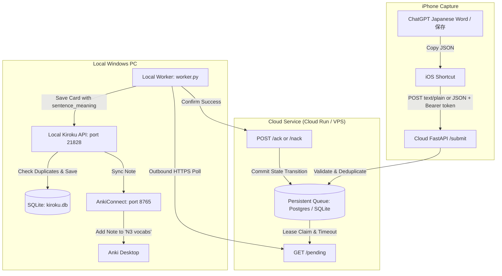

# iPhone Shortcut → Cloud Queue → Kiroku → Anki Pipeline Implementation Plan

> **Goal:** Complete the end-to-end pipeline allowing an iPhone Shortcut to submit Japanese vocabulary cards via `text/plain` POST to an authenticated cloud queue service, durably storing jobs in a persistent database (PostgreSQL/SQLite) with leases and idempotency, drained by a local Windows worker into Kiroku and Anki (`N3 vocabs` deck).

## Architecture Diagram

## Global Constraints
- Directory: Strictly inside `D:\Python\AnkiMiner\kiroku_cloud_queue\` (and `PROGRESS.md` at root).
- Target deck: `N3 vocabs`.
- Content-Types supported on `/submit`: `text/plain` (iPhone Shortcut default) and `application/json`.
- Required card fields: `expression`, `reading`, `meaning`, `sentence`, `sentence_meaning` (non-empty strings, exact Japanese Unicode preserved).
- Auth: Constant-time Bearer token validation with separate phone and worker tokens supported.
- Leases: Atomic claims with configurable timeouts (e.g. 60s) so crashed workers do not lock items.
- Duplicate policy: Local duplicate cards in Kiroku are safely acknowledged without creating duplicate Anki notes.
