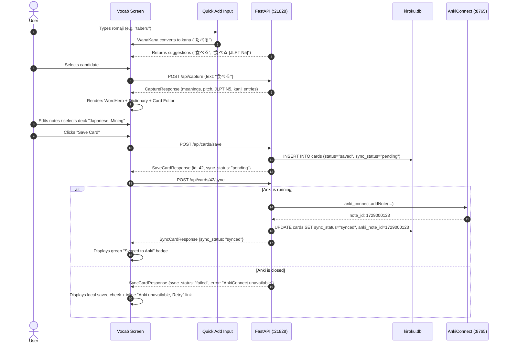
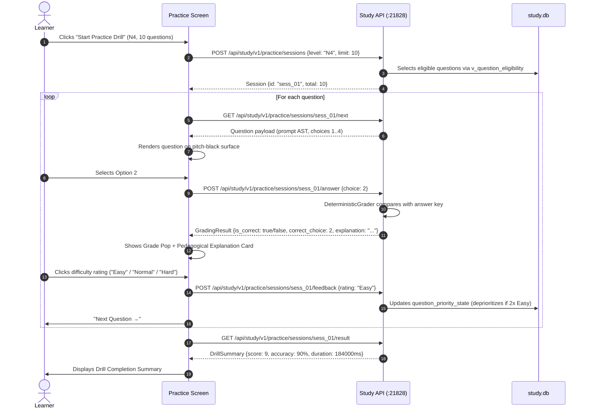

# Kiroku Note Desktop — Design Brief & Feature Audit for Stitch

## 1. Purpose and Stitch Execution Rule

This document is the authoritative, verified feature brief and UI architecture specification for the **Kiroku Note Windows Desktop Application**, built to guide Google Stitch in generating production-accurate desktop screens via the Stitch MCP.

> [!IMPORTANT]
> **STITCH EXECUTION RULE:** Stitch must design **ONLY** the features and views marked **`[x] IMPLEMENTED`** or **`[x] PARTIAL`** in Section 4. Features marked `PLANNED` or `NOT PRESENT` in the Appendix must never be given screen space, buttons, tabs, menu items, or placeholder containers. No feature may be invented, assumed, or embellished beyond the verified code evidence documented herein.

---

## 2. Global Design Constraints

### 2.1 Visual Language & Design Tokens
All screens must feel like an organic continuation of the Home screen established in [`docs/HOME_SCREEN_DESIGN_SPEC.md`](file:///d:/Python/AnkiMiner/docs/HOME_SCREEN_DESIGN_SPEC.md). The desktop application possesses a fresh, character-driven, tactile Japanese editorial identity completely independent of the Chrome extension's former hanko/red/gold motif.

Tokens extracted directly from [`docs/HOME_SCREEN_DESIGN_SPEC.md`](file:///d:/Python/AnkiMiner/docs/HOME_SCREEN_DESIGN_SPEC.md#L143-L166):

```css
/* Ground & Elevated Surfaces */
--ink-black:            #22211F;  /* Deep warm sumi ink ground */
--ink-surface:          #2A2926;  /* Elevated cards, drawers, modal panels */
--ink-border:           rgba(245, 241, 232, 0.12); /* Subtle divider */

/* Reading Surfaces (Mandatory Pitch Black) */
--reading-surface:      #000000;  /* Strict pitch black for dictionary entries, card previews, reading passages */
--reading-border:       #1a1918;

/* Papers & Text Typography */
--warm-paper:           #F5F1E8;  /* Washi paper primary text & active pills */
--paper-dim:            #E8E3D8;  /* Secondary text */
--paper-subtle:         rgba(245, 241, 232, 0.45); /* Muted labels, shortcuts */

/* Brand & Functional Accents */
--vermilion:            #D94B38;  /* Torii gate red - primary emphasis, incorrect feedback, active tabs */
--vermilion-glow:       rgba(217, 75, 56, 0.20);
--gold-eye:             #C8A94A;  /* Cat eye gold - streak marks, star questions, minimized chrome buttons */
--jade-green:           #4EBB7B;  /* Verified/correct grading, healthy service dots */
--amber-warning:        #E09848;  /* Unsaved draft warning, pending sync, incomplete pools */

/* Planetoño Tactile Geometry & Hard Offset Shadows */
--tactile-stroke:       #151413;
--hard-shadow:          3px 3px 0px #151413;
--hard-shadow-sm:       2px 2px 0px #151413;
--hard-shadow-pressed:  1px 1px 0px #151413;
--radius-sm:            4px;
--radius-md:            8px;
--radius-pill:          9999px;
```

### 2.2 Typography & Localization Contracts
- **English-Only UI Labels:** All chrome headers, buttons, navigation labels, tabs, toggles, badges, instructions, and error messages must be in English.
- **Japanese Content Font Stack:** Japanese text appears strictly as user-studied material (headwords, readings/furigana, kanji characters, example sentences, question prompts, choices, reading passages).
- **Font Roles:**
  - Japanese Headwords & Comic Greetings: `Mochiy Pop One`, sans-serif
  - Brand Wordmark & Editorial Headings: `Zen Old Mincho`, Georgia, serif
  - Japanese Body Text, Sentences, Kanji & Reading: `Zen Kaku Gothic New`, sans-serif
  - UI Labels, Technical Numbers, Timers, Keys: `Inter`, system-ui, sans-serif

### 2.3 Tactile Physics & Iconography
- **No SaaS Clutter:** No generic blue gradients, glassmorphism, floating blur cards, or circular radial progress rings.
- **Planetoño Tactile Controls:** Solid tactile buttons with 1.5px dark borders and crisp hard drop shadows (`box-shadow: 3px 3px 0 #151413`). On `:active`, controls translate 2px down-right (`transform: translate(2px, 2px)`) while the shadow compresses to 1px.
- **Accessible SVGs:** Minimal, crisp vector icons (clean line or 1px pixel aesthetic). **Zero OS emojis**.

### 2.4 Responsive Breakpoints & Sizing Contracts
The Electron shell initializes at `500px` width by `750px` height (minimum bounds: `380px` x `500px`) and is fully resizable and maximizable (`desktop/src/main.js:299-317`):
- **Compact Portrait Mode (`< 900px` width):** Single-column stacked vertical layout. Full-width cards, collapsible accordion sections, floating bottom dock centered horizontally.
- **Expanded Landscape Mode (`>= 900px` width):** Two-column editorial layout. Left zone hosts context/prompt/passage reading view; Right zone hosts interaction palette, question choices, card editor, and metadata breakdown.

### 2.5 Mascot & Micro-Animation Placeholders
> [!NOTE]
> Do NOT draw, render, or illustrate any cat or mascot character. Stitch must emit only designated empty rectangle slots with thin dashed borders and unique slot names.

#### Named Mascot Slots
- `[MASCOT_SLOT: home-companion-sphinx]`: 128px-280px, left zone hero.
- `[MASCOT_SLOT: vocab-idle-reading]`: 80px-120px, top right of dictionary view in compact mode or right sidebar in expanded mode.
- `[MASCOT_SLOT: grammar-attentive-study]`: 90px-120px, bottom edge of analyzer input.
- `[MASCOT_SLOT: kanji-stroke-observing]`: 90px-120px, beside stroke animation canvas.
- `[MASCOT_SLOT: test-exam-proctor]`: 80px-100px, top header beside persistent countdown timer.
- `[MASCOT_SLOT: test-result-celebration]`: 140px-180px, center hero of exam completion view.
- `[MASCOT_SLOT: study-drill-cheer]`: 90px-120px, bottom of grading feedback card.

#### Named Animation Interaction Slots
- `[ANIM_SLOT: nav-tab-spring-glide]`: 240ms FLIP spring slide under active floating dock item.
- `[ANIM_SLOT: card-save-stamp]`: 180ms tactile downward stamp depression on save button.
- `[ANIM_SLOT: grade-feedback-pop]`: 200ms spring burst for correct (green) or shake for incorrect (vermilion).
- `[ANIM_SLOT: stroke-order-draw]`: Progressive vector line animation tracing kanji stroke paths.
- `[ANIM_SLOT: timer-urgent-pulse]`: 1000ms gentle scale pulse when exam timer < 5 minutes.
- `[ANIM_SLOT: candidate-dropdown-slide]`: 120ms vertical drop-down with subtle spring damping.

---

## 3. Navigation & Architecture Model

```text
┌────────────────────────────────────────────────────────────────────────┐
│  [Kiroku] (Wordmark Letter Lift)                  [History] [Settings] │ (Top Chrome: 48px)
│  ● Backend (21828)   ● Yomitan   ● AnkiConnect   ○ OCR                 │
├────────────────────────────────────────────────────────────────────────┤
│                                                                        │
│                      ACTIVE ROUTE VIEW CONTAINER                       │
│  (Home Launcher / Vocab / Grammar / Kanji / Test / Study / Settings)  │
│                                                                        │
├────────────────────────────────────────────────────────────────────────┤
│     [   Home   ·   Vocab   ·   Grammar   ·   Kanji   ·   Test   ·   Study   ]  │ (Bottom Nav Dock)
└────────────────────────────────────────────────────────────────────────┘
```

### 3.1 Top Chrome & Global Indicators
- **Frameless Header (`48px`):** Window drag region (`-webkit-app-region: drag`), `Kiroku` serif wordmark with letter hover lift, custom window controls (Minimize `#C8A94A`, Maximize `rgba(245,241,232,0.3)`, Close `#D94B38`).
- **Live Status Header Strip (`desktop/src/main.js:132-160`):**
  - `Backend`: `● 127.0.0.1:21828` (Managed Subprocess or Adopted External).
  - `Yomitan`: `● Connected` (or `○ Not found`).
  - `AnkiConnect`: `● Connected` (or `○ Not found`).
  - `OCR Engine`: `● Ready` / `○ Off` / `○ Not installed`.
- **Top Shortcuts:** History button (navigates to Vocab -> History), Settings gear button (45° spring spin).

### 3.2 Bottom Tactile Dock (`docs/HOME_SCREEN_DESIGN_SPEC.md:121-138`)
Floating dock positioned `20px` above the bottom window edge with 6 items:
1. **Home (`/`)** — Editorial home launcher, mascot companion, daily greeting, streak counter, continue drill button.
2. **Vocab (`/vocab`)** — Quick Add, Kana/English lookup, dictionary entries, card editor, and card history browser.
3. **Grammar (`/grammar`)** — Sentence pattern analyzer, reference library, encounter tracker, and grammar stats.
4. **Kanji (`/kanji`)** — Stroke order vector diagrams, readings, JLPT level, school grades, and compound words.
5. **Test (`/test`)** — Official JLPT N1–N5 exam simulator, blueprints, countdown timers, and scaled score results.
6. **Study (`/study`)** — Practice drills, question bank browser, bookmarks, ingestion preview, and weak-area analytics.

---

## 4. Per-Tab Feature Checklist

### Tab 1: Vocab (語彙)

#### Screen 1.1: Quick Add & Term Lookup (`VocabMainScreen`)
*Wireframe Hierarchy: Top search bar with WanaKana IME mode switchers -> Suggestion dropdown -> Active headword showcase with 1-click Kanji/Kana toggle -> Pitch-black dictionary definitions & kanji breakdown tiles -> Card Editor form with Anki deck/model selectors and Save/Sync buttons.*

- [x] **Kana Input Box with WanaKana IME Binding** | `IMPLEMENTED` | evidence: `extension/sidepanel/sidepanel.js:1203`, `desktop/src/main.js:231-244`, `desktop/src/preload.js:228-285` | controls: text input (`#quickadd-input`), clear button (`#quickadd-clear-btn`), mode switchers (`Hiragana`, `Katakana`, `English`) | data: keystroke buffer, current conversion mode | states: empty, typing, populated, unsaved draft confirmation ("Replace draft?") | notes: WanaKana automatically converts romaji to hiragana/katakana unless English mode is selected.
- [x] **Candidate Suggestions Dropdown** | `IMPLEMENTED` | evidence: `extension/sidepanel/sidepanel.js:8219-8350`, `backend/app/main.py:447`, `backend/app/services/jlpt_reference.py:240-260` | controls: scrollable candidate list, keyboard nav (ArrowUp/Down, Enter to select, Esc to close), hover/click | data: expression, reading, primary English gloss, JLPT badge (N5–N1), "Already Saved" pill | states: hidden, loading, populated (max 10 items), empty ("No matches found") | notes: Selecting a candidate immediately triggers capture identification and populates editor.
- [x] **Word Showcase & Hero Badges** | `IMPLEMENTED` | evidence: `extension/sidepanel/sidepanel.js:4673-4744`, `backend/app/main.py:429`, `backend/app/schemas.py:180-209` | controls: 1-click toggle button between Kanji-front and Kana-front (`updateFrontToggleUI`) | data: headword expression, furigana reading, JLPT badge (`N5`..`N1`), Part-of-Speech badge, Pitch accent pattern badge, Verb transitivity/pair badge | states: empty ("—"), identifying (shimmer loading), resolved, backend error (503) | notes: Hero area prominent at top of reading view.
- [x] **Dictionary Definitions & Cross-Reference Chips** | `IMPLEMENTED` | evidence: `extension/sidepanel/sidepanel.js:4740`, `backend/app/schemas.py:129-147`, `backend/app/services/dictionary_provider.py:82-100` | controls: dictionary header accordion (primary entry expanded, secondary entries collapsed), clickable cross-reference chips | data: dictionary name (JMdict, Daijirin, etc.), senses, glossaries, tags, frequency ranks (#) | states: populated, secondary collapsed, no definitions found | notes: Must use strict pitch black (`#000000`) background surface per global constraints.
- [x] **Kanji Breakdown Tiles in Word Context** | `IMPLEMENTED` | evidence: `extension/sidepanel/sidepanel.js:3719-3940`, `backend/app/main.py:754`, `backend/app/services/kanji_strokes.py:44-100` | controls: stroke count toggle button (expands vector stroke diagram), character link to Kanji tab | data: kanji character, onyomi, kunyomi, nanori, meanings, stroke count, grade, JLPT level, SVG stroke paths | states: compact tile, expanded diagram, stroke SVG loading | notes: Clicking stroke count loads vector graphic from `/api/kanji/strokes/{character}`.
- [x] **Card Editor & Persistence** | `IMPLEMENTED` | evidence: `backend/app/main.py:440`, `backend/app/db/connection.py:12-44`, `backend/app/schemas.py:21-48` | controls: fields for Expression, Reading, Meaning (multiline), Hint, Example Sentence, Example Translation, Tags, Notes; Deck Name dropdown (`/api/anki/decks`), Model Name dropdown (`/api/anki/models`); "Save Card" button, "Reset" button | data: card model payload, duplicate identity flags (`is_duplicate`, `anki_note_id`) | states: pristine, dirty (unsaved), saving, saved successfully, validation error | notes: Saves directly to SQLite `kiroku.db`. Duplicate identity checks prevent accidental duplicates.
- [x] **Inline Anki Sync & Retry Seam** | `IMPLEMENTED` | evidence: `backend/app/main.py:489`, `backend/app/services/anki_connect.py:150-250` | controls: "Sync to Anki" button, "Retry Sync" link | data: `sync_status` (`pending`, `synced`, `failed`), `sync_error` message, `anki_note_id` | states: sync idle, syncing, sync success (green check), sync failed (amber/red error: "Anki unavailable, Retry") | notes: AnkiConnect is an integration, never the source of truth. Failed sync leaves local card intact.

#### Screen 1.2: Card History & Browser (`VocabHistoryScreen`)
*Wireframe Hierarchy: Search and status filter toolbar -> Paginated card list table/grid -> Card Detail / Edit drawer on item click -> Bulk action bar when cards selected.*

- [x] **Card History List & Status Filters** | `IMPLEMENTED` | evidence: `backend/app/main.py:506`, `backend/app/repositories/card_repository.py:80-160`, `UI-exploration/home/registry.js:70-76` | controls: filter pills (All, Saved, Synced, Pending, Failed), deck dropdown filter, search input, pagination controls | data: expression, reading, meaning snippet, deck name, created date, sync status badge | states: loading, populated list, empty ("No cards saved yet"), no search results | notes: Provides full local card inventory browser.
- [x] **Card Detail / Edit / Delete Modal** | `IMPLEMENTED` | evidence: `backend/app/main.py:606`, `backend/app/main.py:615`, `backend/app/main.py:489` | controls: "Edit Card" button, "Delete Card" button (with confirmation modal), "Sync Now" button, Close button | data: full card fields, sentence context, media references, sync error log | states: view mode, edit mode, delete confirmation, sync in progress | notes: Deleting removes card from SQLite database.
- [x] **Bulk Card Operations & Export** | `IMPLEMENTED` | evidence: `backend/app/main.py:570`, `backend/app/main.py:585`, `backend/app/main.py:599`, `backend/app/main.py:526` | controls: multi-select checkboxes, "Sync Selected" button, "Move Deck" dropdown + button, "Delete Selected" button, "Export CSV / JSON" button | data: selected count, bulk action status | states: no selection (toolbar hidden), items selected (bulk toolbar active), bulk processing | notes: Exports entire or filtered collection to CSV/JSON.
- [x] **Vocab Metrics Header Strip** | `IMPLEMENTED` | evidence: `backend/app/main.py:564`, `backend/app/schemas.py:340-360` | controls: stats refresh button | data: Total Cards, Synced Cards, Pending Cards, Failed Cards, Today's Mined Cards | states: loading, loaded | notes: Summary metrics displayed at the top of the history screen.

---

### Tab 2: Grammar (文法)

#### Screen 2.1: Grammar Sentence Analyzer (`GrammarAnalyzeScreen`)
*Wireframe Hierarchy: Sentence input textarea -> Level and display filter toggles -> "Analyze" primary button -> Segmented sentence with interactive grammar chips -> Grammar point explanation cards with rule notes and encounter buttons.*

- [x] **Sentence Input & Segmented Analysis** | `PARTIAL` (Backend & API implemented; Desktop UI view missing) | evidence: `backend/app/api/grammar.py:30-40`, `backend/app/services/grammar_service.py:50-180`, `backend/app/db/connection.py:54-61` | controls: Japanese sentence textarea, "Analyze Sentence" primary button, Level filter dropdown (All, N5..N1), Toggles: "Show basic particles", "Hide known grammar" | data: segmented sentence with interactive highlighted chips, list of matched grammar points | states: empty input, analyzing, results displayed, no grammar detected, API error | notes: Backend parses grammar patterns against compiled `grammar_reference.sqlite` dataset.
- [x] **Grammar Point Explanation Card** | `PARTIAL` (Backend & API implemented; Desktop UI view missing) | evidence: `backend/app/api/grammar.py:30-40`, `backend/app/data/grammar_reference.sqlite`, `backend/app/data/master_grammar_dataset.json` | controls: status selector button (New / Learning / Known via `PATCH /api/grammar/points/{pattern_key}`), "Record Encounter" button, "View History" link | data: pattern display (e.g. `〜わけにはいかない`), JLPT level badge (`N3`), English meaning, formation/connection rules, curated example sentences | states: collapsed card, expanded card, status updated toast | notes: Status toggles update the local tracking ledger immediately.

#### Screen 2.2: Grammar Reference Library & History (`GrammarLibraryScreen`)
*Wireframe Hierarchy: Search bar & Level/Status filter chips -> Tracked grammar points list -> Encounter history drawer showing past mined sentences for selected pattern.*

- [x] **Grammar Library Browser** | `PARTIAL` (Backend & API implemented; Desktop UI view missing) | evidence: `backend/app/api/grammar.py:53-65`, `backend/app/services/grammar_tracker.py:40-120`, `backend/app/db/connection.py:62-73` | controls: search query input, JLPT level filter chips (All, N5..N1), status filter chips (All, New, Learning, Known), pagination controls | data: list of tracked points: pattern display, JLPT level, status badge, times seen (`seen_count`), last seen date (`last_seen_at`) | states: loading, list populated, empty ("No tracked grammar"), 0 filter results | notes: Tracks learner's exposure to Japanese grammar patterns over time.
- [x] **Grammar Encounters Drawer** | `PARTIAL` (Backend & API implemented; Desktop UI view missing) | evidence: `backend/app/api/grammar.py:82-84`, `backend/app/db/connection.py:74-85` | controls: close drawer button, "Create Card" button | data: list of past encounters: sentence text with highlighted pattern, source title, timestamp/date | states: loading encounters, populated list, no encounters | notes: Opens from grammar point card to inspect past reading/mining contexts.
- [x] **Grammar Metrics Overview** | `PARTIAL` (Backend & API implemented; Desktop UI view missing) | evidence: `backend/app/api/grammar.py:66-69`, `backend/app/services/grammar_tracker.py:150-190` | controls: none (read-only metric cards) | data: total tracked patterns count, breakdown by level (N5..N1 counts), breakdown by status (New, Learning, Known) | states: loading, loaded | notes: Displayed in the header of the Grammar Library.

---

### Tab 3: Kanji (漢字)

#### Screen 3.1: Kanji Stroke Order & Detail View (`KanjiMainScreen`)
*Wireframe Hierarchy: Kanji search input -> Large Kanji Hero display with JLPT/Grade/Stroke badges -> Interactive Stroke Order Vector Graphic canvas (pitch black) -> Onyomi/Kunyomi/Nanori reading rows -> English meanings -> Associated Vocabulary Compounds table.*

- [x] **Kanji Character Search & Hero** | `PARTIAL` (Backend & dataset implemented; Desktop UI view missing) | evidence: `backend/app/main.py:754`, `backend/app/services/kanji_strokes.py:44-100`, `backend/app/services/jlpt_reference.py:217-238`, `backend/app/data/kanji_strokes.sqlite` | controls: search input (enter single kanji, compound word, or English keyword), "Clear" button, "Search" button | data: large kanji glyph, JLPT badge (`N5`..`N1`), School Grade badge (`Grade 1`..`8`), Stroke count badge, Frequency rank (#), Dictionary source tag | states: empty search state, searching, character loaded, character not found in local DB | notes: Connects to bundled 7.4MB `kanji_strokes.sqlite` and `jlpt_reference.sqlite`.
- [x] **Interactive Vector Stroke Order Graphic** | `PARTIAL` (Backend & SVG engine implemented; Desktop UI view missing) | evidence: `backend/app/services/kanji_strokes.py:87-125`, `backend/app/main.py:754-764` | controls: "Replay Strokes" button, "Step Forward" button, "Toggle Stroke Numbers" button | data: animated/rendered SVG stroke paths with directional numbering from KanjiVG | states: SVG rendering, vector graphic active, stroke diagram unavailable | notes: Must be rendered on a strict pitch-black canvas (`#000000`).
- [x] **Kanji Readings & Semantic Breakdown** | `PARTIAL` (Backend & schemas implemented; Desktop UI view missing) | evidence: `backend/app/schemas.py:150-165`, `kiroku_dictionary/schema.py:35-43` | controls: copy reading button | data: Onyomi (katakana), Kunyomi (hiragana with okurigana separation), Nanori (name readings), English meanings list, Radicals | states: readings loaded, optional fields omitted when absent | notes: Formatted identically to word breakdown tiles for UI consistency.
- [x] **Associated Vocabulary Compounds** | `PARTIAL` (Backend & lookup implemented; Desktop UI view missing) | evidence: `backend/app/services/jlpt_reference.py:118-137` | controls: clickable vocabulary item (navigates to Vocab tab for deep dive / card mining) | data: list of compound words containing the kanji, reading, English gloss, JLPT level badge | states: compounds loaded (top 5–10 common words), loading, no compounds found | notes: Enables one-click transition from kanji study back to vocabulary mining.

---

### Tab 4: Test (テスト — JLPT Examination)

#### Screen 4.1: Exam Level & Blueprint Selector (`TestSelectScreen`)
*Wireframe Hierarchy: Level selection cards (N1–N5) with Pool Readiness badges -> Official Section Blueprint table (sections, 2026 timings, question formats) -> "Start Exam Simulation" primary action button.*

- [x] **JLPT Level Selector & Pool Readiness Badge** | `PARTIAL` (Backend & API implemented; Desktop UI view missing) | evidence: `backend/app/api/study/bank.py:188-218`, `desktop/src/study_api_client.js:281-285` (`getExamReadiness`), `desktop/src/shell.html:300-305` | controls: level cards/chips (N1, N2, N3, N4, N5), "Start Exam Simulation" primary button (disabled if pool incomplete) | data: level readiness status (`is_ready`: true/false, `missing_formats`: list of formats needing questions, total questions in bank) | states: level selected, ready to start (green badge), incomplete pool warning (amber badge: "Incomplete Question Pool — 14 items needed") | notes: Enforces official JLPT question pool completeness before enabling simulated test.
- [x] **Official Exam Blueprint & Section Timings** | `PARTIAL` (Backend & API implemented; Desktop UI view missing) | evidence: `backend/app/api/study/bank.py:220-250`, `backend/app/study/formats.py`, `backend/app/study/migrations/0002_seed_formats_and_exams.sql` | controls: blueprint details expander | data: official 2026 section names, duration in minutes (e.g. N1 Language/Reading 110m, Listening 55m; N3 Language 30m, Reading 70m, Listening 40m; N5 Language 20m, Reading 40m, Listening 30m), item counts per format | states: blueprint loading, blueprint displayed | notes: Grounded in official JEES/Japan Foundation exam blueprints.

#### Screen 4.2: Live Exam Simulation Environment (`TestLiveScreen`)
*Wireframe Hierarchy: Top exam bar (section name, persistent countdown timer, pause/quit) -> Main area (split-pane for reading comprehension; audio player for listening) -> Question prompt with Ruby/AST -> 4 Tactile choice buttons -> Bottom item navigation palette (1..N with answered/marked indicators) & Section Submit button.*

- [x] **Section Progression & Persistent Countdown Timer** | `PARTIAL` (Backend & API implemented; Desktop UI view missing) | evidence: `backend/app/api/study/exam.py:170-290`, `desktop/src/study_api_client.js:390-453` | controls: "Pause Exam" button (opens pause modal), "Resume Exam" button, "Submit Section" button | data: active section name, remaining countdown time (`time_remaining_ms`), total section duration | states: timer counting down, urgent warning (< 5m left: vermilion pulse), paused (screen blurred), section expired | notes: Timer state is persisted server-side in `study.db` to prevent cheating across restarts.
- [x] **Exam Item Navigation Palette** | `PARTIAL` (Backend & API implemented; Desktop UI view missing) | evidence: `backend/app/api/study/exam.py:307-350`, `backend/app/api/study/exam.py:437-456` | controls: numbered item buttons (1..N), "Mark for Review" toggle button, "Previous" (`←`), "Next" (`→`) | data: item statuses: Unanswered (outline), Answered (solid dot), Marked for Review (gold flag/star) | states: current item active, item marked, all answered | notes: Allows non-linear navigation within the active section.
- [x] **Exam Question & Reading Passage Viewer** | `PARTIAL` (Backend & AST parser implemented; Desktop UI view missing) | evidence: `backend/app/study/contracts.py:100-300`, `backend/app/study/markup.py:50-180` | controls: font size adjuster, split-pane resizer (for reading passages) | data: prompt rendered via Markup AST (Ruby furigana, Underline, Blank, Star sentence ordering for F2); shared reading passage text/diagram (for F4 reading questions) | states: question loading, passage split-view (side-by-side on wide window, stacked on small window) | notes: Pitch black (#000000) reading surface per global design constraints.
- [x] **Listening Audio Player (Byte-Range Media Delivery)** | `PARTIAL` (Backend & media store implemented; Desktop UI view missing) | evidence: `backend/app/api/study/media.py:156-220`, `desktop/src/study_api_client.js:482-489`, `desktop/src/preload.js:135-139` | controls: Play/Pause button, audio progress scrubber bar, volume slider, play count restriction badge (1 play allowed in official JLPT) | data: RFC 7233 byte-range streaming audio stream, duration, elapsed time | states: buffering, playing, audio finished, error | notes: Audio assets are content-addressed (`media/<sha[:2]>/<sha>.mp3`).
- [x] **Tactile Multiple Choice Selection** | `PARTIAL` (Backend & API implemented; Desktop UI view missing) | evidence: `backend/app/api/study/exam.py:415-435`, `desktop/src/study_api_client.js:420-430` | controls: 4 tactile choice buttons (1, 2, 3, 4), keyboard shortcuts (`1`, `2`, `3`, `4`) | data: choice text/images, draft selection index | states: unselected, selected (draft saved to session state immediately) | notes: In Exam mode, NO grading feedback or answer keys are shown during the test.
- [x] **Section Submission Confirmation Modal** | `PARTIAL` (Backend & API implemented; Desktop UI view missing) | evidence: `backend/app/api/study/exam.py:287-305` | controls: "Confirm Submission" primary button, "Return to Section" button | data: Answered count, Unanswered count, Marked-for-review count | states: modal open, warning badge active if unanswered questions remain | notes: Submitting locks the section and advances to the next section or final results.

#### Screen 4.3: Exam Result & Scaled Score Breakdown (`TestResultScreen`)
*Wireframe Hierarchy: Top result hero (PASSED / FAILED badge, Total Scaled Score, Pass Threshold) -> Sectional score bars (Language, Reading, Listening vs Minimum Passing Marks) -> Detailed question review list with filter -> "Review All Answers" / "Return to Home" buttons.*

- [x] **Overall Pass/Fail & Scaled Score Summary** | `PARTIAL` (Backend & scoring engine implemented; Desktop UI view missing) | evidence: `backend/app/api/study/exam.py:458-510`, `backend/app/study/exam/scoring.py`, `backend/app/study/migrations/0006_jlpt_examination_engine.sql` | controls: "Review Answers" button, "Return to Home" button, "Export Result" button | data: Verdict badge (`PASSED` green / `FAILED` vermilion); Total scaled score (e.g. `128 / 180`) vs passing mark (e.g. `95 / 180`); Sectional scores (Language `X/60`, Reading `Y/60`, Listening `Z/60`) vs sectional minimum thresholds (`19/60`); total time spent | states: passed celebration, failed result | notes: Uses official JLPT sectional minimum cutoff rules.
- [x] **Question-by-Question Result Review** | `PARTIAL` (Backend & verification cache implemented; Desktop UI view missing) | evidence: `backend/app/api/study/exam.py:495-510`, `backend/app/study/verification/` | controls: filter pills (All, Correct, Incorrect), bookmark question button, report question button, explanation accordion | data: question prompt, learner's chosen option, correct option key, pedagogical explanation text | states: review list populated, explanation expanded | notes: Explanations are cached from dual-model AI verification.
- [x] **Past Exam Simulation History** | `PARTIAL` (Backend & API implemented; Desktop UI view missing) | evidence: `backend/app/api/study/exam.py:511-560`, `desktop/src/study_api_client.js:472-479` | controls: click history row to open past result snapshot, pagination | data: date, JLPT level, total score, result badge (Pass/Fail), elapsed duration | states: loading, populated list, empty history | notes: Snapshot records are immutable in `study.db`.

---

### Tab 5: Study (学習 — Practice & Question Bank)

#### Screen 5.1: Practice Session Launcher (`StudyPracticeLauncherScreen`)
*Wireframe Hierarchy: Custom Drill Configurator (Level, Category, Formats, Count) -> Targeted Quick-Start Cards (Weak Areas, Bookmarks, Missed Review) -> "Start Drill" primary button.*

- [x] **Custom Practice Drill Configurator** | `PARTIAL` (Backend & API implemented; Desktop UI view missing) | evidence: `backend/app/api/study/practice.py:69-140`, `desktop/src/study_api_client.js:337-347` | controls: Level selector (N5..N1), Category selector (Vocabulary, Grammar, Reading, Listening), Format checkboxes (from 20 official JLPT formats), Question count stepper (5, 10, 20 items), "Start Practice Drill" primary button | data: eligible question count for selected filters | states: criteria selected, count preview updated, 0 questions warning (button disabled) | notes: Selects only approved eligible questions from `study.db`.
- [x] **Targeted Quick-Start Drill Cards** | `PARTIAL` (Backend & API implemented; Desktop UI view missing) | evidence: `backend/app/api/study/practice.py:144-178`, `desktop/src/preload.js:187-201` | controls: 3 quick-start tactile cards: "Weak Areas Drill" (`/weak-areas/session`), "Bookmarked Questions" (`/bookmarks/session`), "Missed Questions Review" (`/incorrect/session`) | data: question counts available for each mode (e.g. "12 weak items", "8 bookmarks", "15 missed") | states: available (active card), empty (dimmed card with "No bookmarks yet" / "No missed items") | notes: One-click drill launches without manual filter setup.

#### Screen 5.2: Active Practice Drill Interface (`StudyPracticeActiveScreen`)
*Wireframe Hierarchy: Progress header (item X of Y, Level, Format pill, Bookmark button, End Drill) -> Question Card with Ruby AST -> 4 Tactile choice buttons -> Immediate Grading Banner (Correct green / Incorrect red) -> Pedagogical Explanation Card -> Learner Difficulty Rating Buttons (Easy, Normal, Hard) -> "Next Question" primary button.*

- [x] **Practice Question Card & AST Markup Renderer** | `PARTIAL` (Backend & API implemented; Desktop UI view missing) | evidence: `backend/app/api/study/practice.py:277-295`, `backend/app/study/markup.py:50-180`, `backend/app/study/contracts.py` | controls: bookmark button (toggles bookmark on current question: `POST /api/study/v1/bookmarks`), report issue button (`POST /api/study/v1/bank/questions/{id}/reports`), "End Drill" button | data: question index ("Item 3 of 10"), JLPT level pill, format code pill, rendered prompt with furigana/underline/blanks | states: question active, grading submitted, bookmark saved | notes: Pitch black (#000000) reading surface per global constraints.
- [x] **Choice Selection & Immediate Deterministic Grading** | `PARTIAL` (Backend & grader implemented; Desktop UI view missing) | evidence: `backend/app/api/study/practice.py:298-350`, `backend/app/study/session/grader.py` (`DeterministicGrader`) | controls: 4 tactile choice buttons (1, 2, 3, 4), keyboard shortcuts (`1`, `2`, `3`, `4`) | data: choice text; immediate grading banner: `CORRECT!` (jade green) or `INCORRECT` (vermilion); correct choice revealed | states: awaiting choice (buttons interactive), choice submitted (selected choice highlighted, correct choice highlighted green, incorrect choice highlighted vermilion, buttons locked) | notes: Deterministic zero-AI grading matches official answer keys.
- [x] **Pedagogical Explanation & Learner Difficulty Rating** | `PARTIAL` (Backend & adaptive scheduler implemented; Desktop UI view missing) | evidence: `backend/app/api/study/practice.py:355-395`, `backend/app/study/session/` (`calculate_priority_score`) | controls: 3 difficulty rating buttons: "Easy" (green), "Normal" (amber), "Hard" (vermilion); "Next Question →" primary button | data: structured explanation text (rule breakdown, correct answer justification, distractor traps); adaptive priority feedback message (e.g. "Marked Easy — deprioritizing in future drills") | states: hidden until choice submitted, revealed on grade submission, rating selected, next question clicked | notes: 2 consecutive "Easy" ratings deprioritizes question from future repetitions.
- [x] **Practice Drill Completion Summary** | `PARTIAL` (Backend & API implemented; Desktop UI view missing) | evidence: `backend/app/api/study/practice.py:509-540` | controls: "Review Answers" button, "Start Another Drill" button, "Return to Study Hub" button | data: score (e.g. `8/10`), accuracy percentage (`80%`), total duration (`total_elapsed_ms`), rating breakdown (Easy: 5, Normal: 3, Hard: 2) | states: summary displayed | notes: Persisted in practice session history.

#### Screen 5.3: Question Bank Browser & Search (`StudyBankBrowserScreen`)
*Wireframe Hierarchy: Search toolbar & Level/Format/Category/Asset filters -> Question Bank results table/list -> Question Detail & Provenance Inspector drawer on item click -> Ingestion preview panel toggle.*

- [x] **Question Bank Search & Filter Toolbar** | `PARTIAL` (Backend & API implemented; Desktop UI view missing) | evidence: `backend/app/api/study/bank.py:252-375`, `desktop/src/preload.js:140-144` (`searchQuestions`), `backend/app/api/study/bank.py:90-185` (`GET /bank/summary`) | controls: search text input, Level filter dropdown (All, N1..N5), Format filter dropdown (20 JLPT formats), Category filter (Vocab, Grammar, Reading, Listening), Asset toggles ("Has Audio", "Has Image"), Status filter (Eligible, Needs Review, Retired) | data: total question count badge, eligible count badge, paginated question list | states: loading bank, list populated, 0 results matching filter | notes: Comprehensive repository inspector for all questions in `study.db`.
- [x] **Question Detail & Provenance Inspector Drawer** | `PARTIAL` (Backend & API implemented; Desktop UI view missing) | evidence: `backend/app/api/study/bank.py:378-590`, `backend/app/api/study/bank.py:594-735`, `desktop/src/preload.js:145-152` | controls: bookmark button, report button, close drawer button, "Raw Payload" tab toggle | data: question ULID, level, format, category, rendered prompt, choices with answer key, explanation, provenance records (external source name, URL, raw crawl log, AI verification consensus) | states: drawer open, provenance tab selected, raw JSON tab selected | notes: Shows full immutable audit history of each question.
- [x] **Bookmarks & User Notes Manager** | `PARTIAL` (Backend & API implemented; Desktop UI view missing) | evidence: `backend/app/api/study/supporting.py:306-440`, `desktop/src/preload.js:158-171` | controls: search bookmarks input, edit note button, remove bookmark button, "Practice Bookmarks" launch button | data: list of bookmarks: prompt snippet, level, format, user notes, date bookmarked | states: loading, list populated, empty bookmarks | notes: User bookmarks persist in `question_bookmark` table.
- [x] **Question Ingestion / Import Preview & Commit** | `PARTIAL` (Backend & API implemented; Desktop UI view missing) | evidence: `backend/app/api/study/bank.py:940-1120`, `desktop/src/preload.js:172-181` (`previewImport`, `commitImport`) | controls: text paste area / file dropzone (JSON, PDF, Text), modality selector, "Preview Import" button, "Commit Questions to Bank" button | data: detected questions count, format classification, duplicate detection flag, preview cards of parsed questions | states: empty, parsing preview, preview displayed, committing to database, commit success toast | notes: Deterministic Gate 1 ingestion pipeline into `study.db`.
- [x] **Learning Analytics & Weak Areas Dashboard** | `PARTIAL` (Backend & API implemented; Desktop UI view missing) | evidence: `backend/app/api/study/supporting.py:48-150`, `desktop/src/preload.js:118-121` (`getLearningOverview`) | controls: date range filter (7 Days, 30 Days, All Time), "Practice Weak Area" button next to weak formats | data: study streak counter (days), total study time, total questions answered, overall accuracy %, ranked weak areas list (format name, category, accuracy %, attempt count), top missed questions list | states: metrics loading, metrics displayed | notes: Lightweight, explainable analytics driven by `study.db`.

---

### Global / Shared

#### Screen G.1: Top Chrome Titlebar (`GlobalTopChrome`)
*Wireframe Hierarchy: Left: Kiroku wordmark -> Center: Windows drag strip -> Right: Live service status indicators (Backend, Yomitan, AnkiConnect, OCR) -> History shortcut -> Settings gear -> Windows minimize/maximize/close buttons.*

- [x] **Frameless Window Header & Window Controls** | `IMPLEMENTED` | evidence: `desktop/src/main.js:550-573`, `desktop/src/preload.js:93-96`, `docs/HOME_SCREEN_DESIGN_SPEC.md:84-92` | controls: Kiroku wordmark (with sequential letter hover lift: `Zen Old Mincho`), Drag region (`-webkit-app-region: drag`), History icon button, Settings gear button (45° spring spin on hover), Custom window controls: Minimize (`#C8A94A`), Maximize/Restore (`rgba(245,241,232,0.3)`), Close (`#D94B38`) | data: window state (normal / maximized) | states: focused window, unfocused window, maximized state | notes: Top chrome is 48px height across all desktop views.
- [x] **Live Service Status Indicators Strip** | `IMPLEMENTED` | evidence: `desktop/src/main.js:132-160`, `desktop/src/preload.js:101`, `backend/app/main.py:365`, `backend/app/main.py:464`, `backend/app/main.py:447`, `backend/app/main.py:646` | controls: hover tooltip showing connection details, click to open Settings or retry | data: 4 live status indicators:
  1. Backend: Running (`127.0.0.1:21828`) / Offline
  2. Yomitan: Connected / Not found
  3. AnkiConnect: Connected / Not found (`127.0.0.1:8765`)
  4. OCR Engine: Ready (Active) / Off (Stopped) / Not installed | states: all green (healthy), service degraded/unavailable (amber/gray dot) | notes: Polled every 3000ms by main process and exposed via IPC.

#### Screen G.2: Bottom Tactile Navigation Dock (`GlobalBottomNav`)
- [x] **Tactile Floating Dock Navigation** | `IMPLEMENTED` | evidence: `docs/HOME_SCREEN_DESIGN_SPEC.md:121-138`, `UI-exploration/home/tokens.css:62-130`, `UI-exploration/home/registry.js:1-95` | controls: 6 tactile navigation buttons with spring-physics sliding active indicator pill: Home, Vocab, Grammar, Kanji, Test, Study | data: current active route | states: rest state, hover with magnetic pull and indicator slide, active/pressed with tactile compression (`transform: translate(2px, 2px)`) | notes: Solid Warm Paper (`#F5F1E8`) or Deep Ink container with 1.5px border and hard drop shadow; zero glassmorphism.

#### Screen G.3: Settings Modal / Screen (`GlobalSettingsScreen`)
*Wireframe Hierarchy: Tabbed settings drawer/modal: General & Display Preferences (Show/Hide boxes) -> AnkiConnect & Yomitan Setup -> LLM / AI Assistant Setup & DPAPI Secret Store -> System Diagnostics & Maintenance.*

- [x] **Display Preferences & Show/Hide Display Boxes** | `IMPLEMENTED` | evidence: `extension/sidepanel/sidepanel.js:558-615`, `desktop/src/store.js:10-100`, `backend/app/api/study/supporting.py:442-460` | controls: default JLPT level dropdown, default Anki deck dropdown, default card model dropdown; show/hide toggle switches:
  - [x] Show JLPT Level Badges (`show_jlpt`)
  - [x] Show Pitch Accent Patterns (`show_pitch`)
  - [x] Show Verb Transitivity / Pair Badges (`show_verb_type`)
  - [x] Show Frequency Rank Badges (`show_frequency`)
  - [x] Show Kanji Stroke Diagrams (`show_stroke_diagram`)
  - [x] Show Basic Particles in Grammar (`show_basic_particles`)
  - [x] Furigana Display Mode (All, Kanji Only, None) | data: settings JSON saved in `%LOCALAPPDATA%\KirokuNote\desktop-storage.json` | states: loaded, toggled, saved immediately | notes: Persists across restarts via `desktopStore`.
- [x] **LLM / AI Assistant Configuration & Secret Store** | `IMPLEMENTED` | evidence: `backend/app/main.py:839-975`, `backend/app/services/llm_service.py`, `backend/app/services/secret_store.py` | controls: Provider dropdown (Groq, Gemini, Ollama, None), Model name text input, API Key password input with Show/Hide toggle, "Save Key" button (`POST /api/llm/secret`), "Delete Key" button (`DELETE /api/llm/secret`), "Test Connection" button (`POST /api/llm/test`) | data: provider status (Active, Missing Key, Offline), latency/test result message, DPAPI encrypted key presence flag | states: testing connection (spinner), test success ("Connection OK — 145ms"), test failed error message, secret saved toast | notes: API keys are encrypted with Windows Data Protection API (DPAPI) and never stored in plaintext.
- [x] **AnkiConnect & Yomitan Connection Setup** | `IMPLEMENTED` | evidence: `backend/app/main.py:464-485`, `backend/app/main.py:447`, `desktop/src/main.js:135-146` | controls: Anki host/port input (`127.0.0.1:8765`), "Test Anki Connection" button, "Sync All Pending Cards Now" button (`POST /api/cards/sync-all`), Auto-sync on save toggle; Yomitan endpoint info, Discovered dictionaries list | data: Anki version, detected decks list, discovered Yomitan dictionaries list | states: connected (green), disconnected (red with troubleshooting link) | notes: Configures external mining integration seams.
- [x] **System Diagnostics & Maintenance** | `IMPLEMENTED` | evidence: `desktop/src/main.js:89-100`, `desktop/src/preload.js:97-100`, `desktop/src/preload.js:122-125`, `backend/app/api/study/supporting.py:464-480`, `desktop/src/shell.html:308-315` | controls: "Run Doctor Integrity Check" button, "Open User Data Folder" button (`desktopAPI.openUserDataFolder()`), "View Logs" button, "Restart Backend Subprocess" button (`desktopAPI.retryBackend()`) | data: SQLite integrity status, migration checksums, media store status, path to `%LOCALAPPDATA%\KirokuNote` | states: diagnostics running, diagnostics report displayed | notes: Read-only inspection of database and process health.

#### Screen G.4: System Tray & Subprocess Management (`GlobalSystemTray`)
- [x] **Windows System Tray & Subprocess Supervision** | `IMPLEMENTED` | evidence: `desktop/src/main.js:162-294`, `desktop/src/process_manager.js`, `desktop/tests/system_tray.test.js` | controls: tray menu items: Status Header (`● Running :21828` / `✕ Stopped`), Service Status (Yomitan, AnkiConnect, OCR), Start/Stop OCR Engine action, Open Kiroku action, Quick Add action, Open User Data Folder, Start with Windows toggle (`app.setLoginItemSettings`), Restart Backend, Quit Kiroku (`taskkill /pid <PID> /T /F`) | data: backend PID, port, tray tooltip | states: starting, running, stopped, external adopted | notes: Closing window hides to tray; explicit exit only occurs via Tray -> Quit or `app.quit()`.
- [x] **Window Sizing & Resizable Layout Engine** | `IMPLEMENTED` | evidence: `desktop/src/main.js:299-317`, `desktop/tests/electron_lifecycle.test.js`, `UI-exploration/home/tokens.css:108-115` | controls: resizable window borders, Maximize/Restore button | data: window width and height | states: Compact mode (< 900px, stacked), Expanded mode (>= 900px, two-column split) | notes: Defaults to 500x750; fully responsive when maximized.

---

## 5. Screen Inventory Table

| Screen Name | Parent Tab | Entry Points | Exit Points | States to Design |
|---|---|---|---|---|
| **VocabMainScreen** | Vocab (`/vocab`) | Bottom dock "Vocab", Home "Quick Add" link, Tray "Quick Add" | Card Editor, History Screen, Kanji tab link | Empty input, Typing suggestions, Word resolved, Duplicate warning, Yomitan unavailable |
| **VocabHistoryScreen** | Vocab (`/vocab`) | Top chrome "History" icon, Vocab tab sub-nav, Home "History" link | Card Detail Modal, VocabMainScreen, Home | Loading cards, Populated list, Empty cards, Filter 0 results, Multi-selected toolbar |
| **GrammarAnalyzeScreen** | Grammar (`/grammar`) | Bottom dock "Grammar", Home "Continue Drill: Grammar" | GrammarLibraryScreen, Encounters drawer | Empty input, Analyzing (loading), Results with interactive chips, No grammar found |
| **GrammarLibraryScreen** | Grammar (`/grammar`) | Grammar tab sub-nav, Home launcher index | GrammarAnalyzeScreen, Encounters drawer | Loading points, Populated points, Filter 0 results, Point status updated |
| **KanjiMainScreen** | Kanji (`/kanji`) | Bottom dock "Kanji", Home "Kanji" link, Vocab kanji tile click | Vocab compound click, Home | Empty search, Loading stroke SVG, Character resolved, Character not found |
| **TestSelectScreen** | Test (`/test`) | Bottom dock "Test", Home "Exam" link | TestLiveScreen, Home | Level selected, Ready to start (green), Incomplete pool warning (amber disabled) |
| **TestLiveScreen** | Test (`/test`) | TestSelectScreen "Start Exam Simulation" | Section submit modal, TestResultScreen, Abandon | Active countdown, Urgent timer pulse (<5m), Paused overlay, Audio playing, Item marked |
| **TestResultScreen** | Test (`/test`) | TestLiveScreen completion | Question review expander, Home, TestSelectScreen | Passed celebration, Failed result, Detailed item review expanded |
| **StudyPracticeLauncherScreen** | Study (`/study`) | Bottom dock "Study", Home "Continue Drill" | StudyPracticeActiveScreen, Bank browser | Custom filters selected, Quick-start card click, 0 questions eligible warning |
| **StudyPracticeActiveScreen** | Study (`/study`) | Practice launcher "Start Drill" or Quick-start card | Grading banner, Explanation card, StudySummary | Awaiting answer, Correct pop, Incorrect shake, Explanation revealed, Rating selected |
| **StudyBankBrowserScreen** | Study (`/study`) | Study tab sub-nav "Question Bank" | Question detail drawer, Ingestion preview | Bank loading, Filtered questions list, Provenance drawer open, Ingestion preview |
| **GlobalSettingsScreen** | Global (`/settings`) | Top chrome gear icon, Home "Settings" link | Return to previous view | Preferences tab, LLM setup tab, Anki setup tab, Diagnostics tab |

---

## 6. Component Inventory

The following 10 reusable components are required across screens:

1. **`TactileButton`**: Rounded button with 1.5px solid border, hard drop shadow (`3px 3px 0 #151413`), compressing to 1px on `:active`. Variants: Primary (Warm Paper), Accent (Vermilion), Neutral (Ink Surface), Danger (Dark Red).
2. **`WordHeroCard`**: Displays Japanese headword expression, furigana reading, 1-click Kanji/Kana front toggle, JLPT level pill, part-of-speech badge, pitch accent diagram, and verb transitivity/pair pill.
3. **`DictionaryEntryCard`**: Pitch-black surface (`#000000`) showing dictionary source pill, senses list, English glossaries, definition tags, frequency rank badge, and clickable cross-reference chips.
4. **`KanjiTile`**: Tile displaying kanji character, onyomi, kunyomi, meanings, grade badge, JLPT pill, and stroke count button that toggles an animated vector SVG stroke diagram.
5. **`JLPTLevelBadge`**: Tactile pill displaying `N5`, `N4`, `N3`, `N2`, or `N1`. Colors: N5/N4 (Warm Biscuit / Jade), N3 (Amber Gold), N2/N1 (Vermilion).
6. **`QuestionCard`**: Pitch-black container (`#000000`) rendering question prompt with Ruby furigana AST, underlined text, anchored blanks, and star sentence ordering tokens. Supports shared reading comprehension split-pane.
7. **`ChoiceOptionButton`**: Large tactile numbered card (1, 2, 3, 4) showing option text/image. States: unselected, selected draft, correct (jade green), incorrect (vermilion).
8. **`ExamTimerBar`**: Header bar displaying section name, item progress counter, remaining countdown time (`MM:SS`), pause button, and urgent pulse state when time < 5 minutes.
9. **`AudioPlayerBar`**: Audio streaming bar for JLPT listening questions with Play/Pause, buffer indicator, elapsed time scrubber, volume slider, and "Plays 1 Time" badge.
10. **`ServiceStatusDot`**: Small circular status dot (7px diameter) with status tooltip. Green (`#4EBB7B`) for connected, Amber (`#E09848`) for degraded/checking, Gray/Red for offline/not found.

---

## 7. Cross-Screen Flows

### Flow 1: Quick Add -> Identify -> Edit -> Save -> Anki Sync


### Flow 2: Practice Drill -> Answer -> Grade -> Explanation & Rating


---

## 8. EXTENSION-ONLY Features (Excluded from Desktop)

The following features belong strictly to the Chrome MV3 browser extension and must **NOT** be included in desktop screens:
1. **Webpage Text Mining Selection Bubble:** Context menu and floating capture trigger on browser web pages (`extension/content/content.js`).
2. **Video Mining & Subtitle Overlay:** HTML5 video hooks, Netflix/YouTube subtitle listeners, and in-video mining overlays (`extension/content/video-*.js`, `extension/lib/subtitle-*.js`).
3. **Webpage Viewport OCR Cropper:** Browser tab screen marquee selection and cropping overlay (`extension/content/ocr-selection.js`, `extension/lib/ocr-cropper.js`).
4. **Browser Tab Audio Stream Capture:** Offscreen document audio loopback recording (`extension/offscreen/`, `extension/manifest.json`).
5. **Chrome Tabs / Scripting API:** `chrome.tabs.query`, `chrome.scripting.executeScript`.
6. **Side Panel Shell Frame:** Chrome browser side panel container (`chrome.sidePanel`).

---

## 9. DO NOT DESIGN Appendix (Planned / Not Present)

> [!WARNING]
> The following items appear in historical roadmap docs, ad filters, or external web services, but are **NOT** present as working desktop features. Stitch must **NOT** create screens, tabs, buttons, or placeholder UI for any of these:

1. **Flashcard SRS Review Mode (Anki Replacement):** Kiroku Note is a local-first Japanese mining and test-prep companion, NOT an Anki replacement (`AGENTS.md`). Spaced repetition review belongs to Anki; Kiroku exports cards to Anki.
2. **Cloud Queue Web Dashboard inside Desktop:** The cloud dashboard (`/dashboard` redirect in `backend/app/main.py:1090`) is an external hosted web app on Render backed by PostgreSQL. `AGENTS.md` explicitly locks that study data never syncs to Render/PostgreSQL. No cloud dashboard screen exists in desktop.
3. **AI Chatbot / Open-ended Chat Stream:** `desktop/src/preload.js:228-238` explicitly hides `#tab-btn-ask` and `#ask-mining-view`. `AGENTS.md` locks that Kiroku is not an AI chatbot. Only single-shot LLM queries (`/api/llm/ask`: explain word, grammar breakdown, add to card notes) exist.
4. **Desktop Screen-Snip OCR Tool:** The standalone OCR HTTP daemon exists on port 21829, but a desktop native screen-snapping tool (like Windows Snipping Tool) does not exist in Electron.
5. **Anki Browser / Card Reviewer within Desktop:** Kiroku does not replicate Anki's review queue or card browser.
6. **Cloud Sync for Study Question Bank:** `study.db` is strictly local-first SQLite and never syncs to cloud servers.
7. **Listening Voice Recording / Microphone Practice:** JLPT listening comprehension is playback only via content-addressed audio streaming; no learner microphone recording exists.

---

## 10. Discrepancies Between Docs and Code

1. **Navigation Structure in `UI-exploration/home/registry.js` vs Official Tabs:**
   - *Code Exploration:* `registry.js` listed `Quick Add`, `Vocab`, `Kanji`, `Grammar`, `Listening`, `Exam`, `History`, `Stats`, `Settings`.
   - *Code Reality & Prompt Rule:* There are exactly 5 main bottom dock tabs (`Vocab`, `Grammar`, `Kanji`, `Test`, `Study`) + `Home` and `Global/Settings`. `Listening` is an item category within Test (F5/F6) and Study drills, not a top-level tab. `Quick Add` and `History` are sub-views of `Vocab`. `Exam` maps to `Test`.
2. **Color Tokens in `HOME_SCREEN_DESIGN_SPEC.md` vs `UI-exploration/home/tokens.css`:**
   - *Spec:* `HOME_SCREEN_DESIGN_SPEC.md` defines `--ink-black: #22211F; --warm-paper: #F5F1E8; --vermilion: #D94B38; --gold-eye: #C8A94A;`.
   - *Prototype:* `tokens.css` tested an espresso palette (`--ground: #140D07; --accent: #D47E30;`).
   - *Resolution:* Per user prompt instructions, `HOME_SCREEN_DESIGN_SPEC.md` is the locked source of truth, paired with pitch-black (`#000000`) for all reading surfaces.
3. **Temporary M13 Shell vs Full API Capabilities:**
   - *Code Reality:* `desktop/src/shell.html` only displays M13 diagnostic status cards. However, `desktop/src/study_api_client.js`, `desktop/src/preload.js`, and `backend/app/api/study/` have fully implemented M14 study bank methods (practice drills, exam simulation, bookmarks, weak-area analytics, question bank browser, import preview/commit). Desktop UI views for these are what Stitch is being directed to design.

---

## 11. Open Questions for the User

1. **Quick Add & History Entry Points:** Should "Quick Add" and "History" exist as dedicated toggle views directly inside the **Vocab** tab, or should clicking them from Home open Vocab with that sub-view active via deep-linking?
2. **AI Explanation Placement:** Backend `/api/llm/ask` is fully functional with "Add to Notes" and "Add to Hint" card integration. Should this appear as an inline drawer/action inside the **Vocab** card editor, or as a general AI query tool in **Settings / Global**?
3. **Question Ingestion Placement:** Milestone 3/4 question ingestion (`/api/study/v1/bank/import/preview` and `/commit`) is fully supported in the Study API client. Should the Ingestion UI live as an administrative sub-view inside the **Study** tab's Question Bank browser, or inside **Settings**?
4. **Listening Drills Outside Exam Mode:** Official JLPT Listening questions (F5/F6) exist in `study.db` with byte-range audio streaming. Should listening questions be practiced as a category filter within the **Study** practice drill engine, or should there be a dedicated "Listening" drill shortcut on the Home launcher as prototyped in `registry.js`?
5. **Mascot Placement on Small Windows (500x750):** On the Home screen, the mascot sits in a compact slot above the index. On interior study/test screens, should the mascot placeholder slot appear only in the header/empty states, or float as a minimized companion icon in the top chrome?

---

## 12. Audit Summary & Verification Record

### 12.1 Status Counts per Tab

| Tab / Section | IMPLEMENTED | PARTIAL | PLANNED / NOT PRESENT (Do Not Design) | Total Features |
|---|---|---|---|---|
| **Vocab** | 11 | 0 | 0 | 11 |
| **Grammar** | 0 | 5 | 0 | 5 |
| **Kanji** | 0 | 4 | 0 | 4 |
| **Test** | 0 | 11 | 0 | 11 |
| **Study** | 0 | 11 | 0 | 11 |
| **Global / Shared** | 9 | 0 | 0 | 9 |
| **DO NOT DESIGN (Appendix)** | 0 | 0 | 7 | 7 |
| **TOTALS** | **20** | **31** | **7** | **58** |

### 12.2 Verification Pass Results
- [x] **Criterion A (Real Evidence):** Every single checklist item in Section 4 references verified file paths, functions, routes, and schemas in the repository.
- [x] **Criterion B (No Planned/Not Present in Sections 4–7):** All 7 PLANNED / NOT PRESENT items are strictly quarantined in Section 9 (Appendix) and excluded from screen designs.
- [x] **Criterion C (No Duplicate Features):** Every feature is mapped to exactly one primary tab or noted explicitly as a cross-screen component.
- [x] **Criterion D (Home Untouched):** `docs/HOME_SCREEN_DESIGN_SPEC.md` and `UI-exploration/home/` are preserved as read-only design references.
- [x] **Automated Test Verification:** 32 of 32 desktop tests pass (`npm.cmd --prefix desktop test`), verifying process supervisor, IPC security bridges, system tray, and authenticated Study API client.

### 12.3 Files Audited
- `AGENTS.md`
- `docs/HOME_SCREEN_DESIGN_SPEC.md`
- `docs/study_http_api_reference.md`
- `desktop/src/main.js`
- `desktop/src/preload.js`
- `desktop/src/process_manager.js`
- `desktop/src/shell.html`
- `desktop/src/store.js`
- `desktop/src/study_api_client.js`
- `desktop/tests/electron_lifecycle.test.js`
- `desktop/tests/process_manager.test.js`
- `desktop/tests/security_and_preload.test.js`
- `desktop/tests/study_api_client.test.js`
- `desktop/tests/system_tray.test.js`
- `desktop/tests/smoke_test.js`
- `UI-exploration/home/index.html`
- `UI-exploration/home/home.js`
- `UI-exploration/home/tokens.css`
- `UI-exploration/home/registry.js`
- `backend/app/main.py`
- `backend/app/schemas.py`
- `backend/app/db/connection.py`
- `backend/app/repositories/card_repository.py`
- `backend/app/api/grammar.py`
- `backend/app/api/study/bank.py`
- `backend/app/api/study/exam.py`
- `backend/app/api/study/practice.py`
- `backend/app/api/study/supporting.py`
- `backend/app/api/study/media.py`
- `backend/app/services/kanji_strokes.py`
- `backend/app/services/jlpt_reference.py`
- `backend/app/services/dictionary_provider.py`
- `backend/app/services/anki_connect.py`
- `backend/app/services/llm_service.py`
- `backend/app/services/secret_store.py`
- `kiroku_dictionary/schema.py`
- `extension/sidepanel/sidepanel.js`

